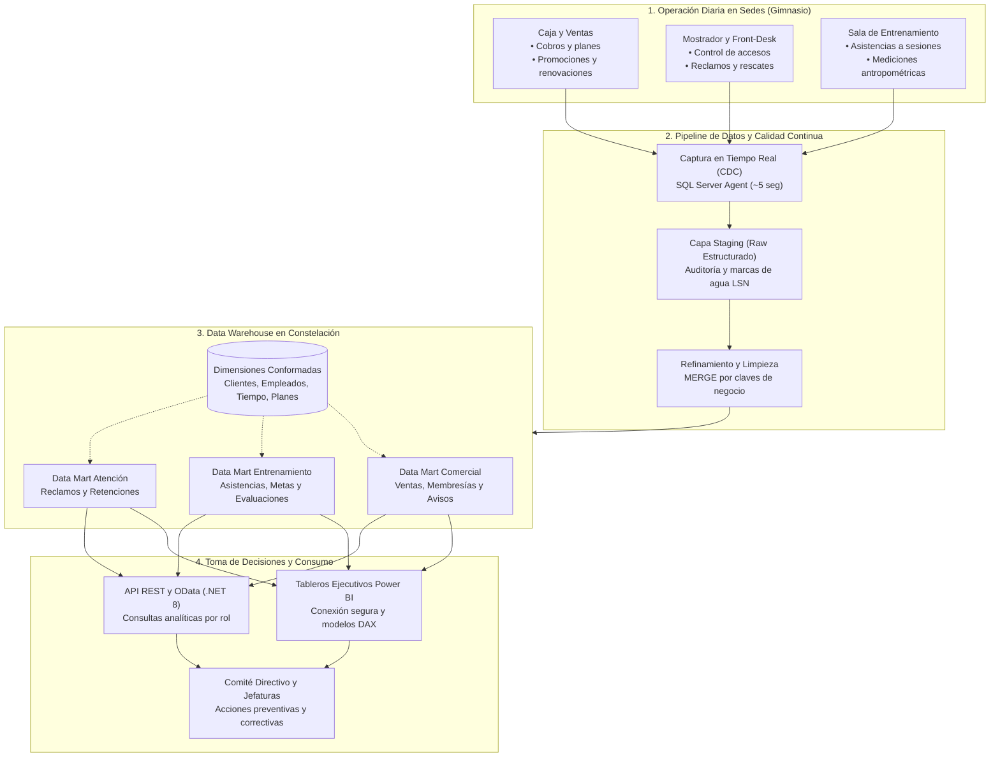
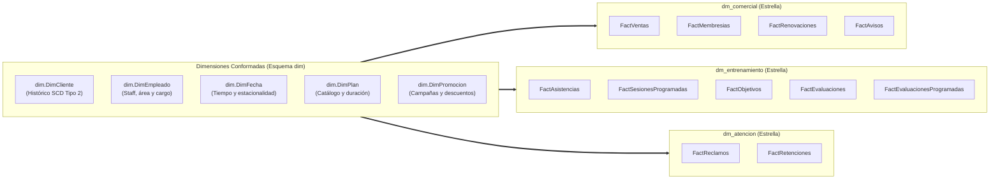
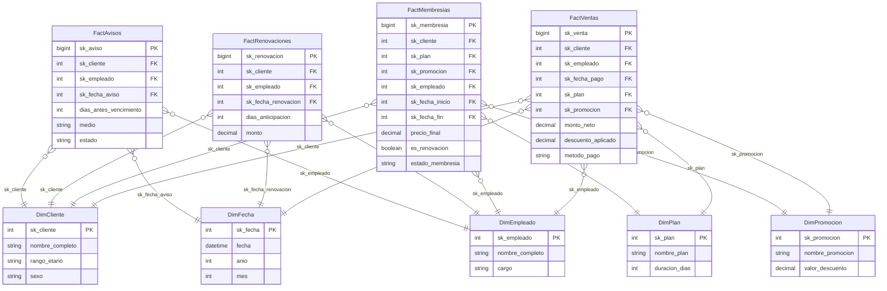
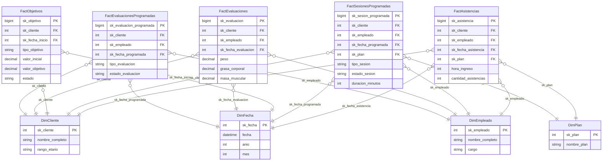
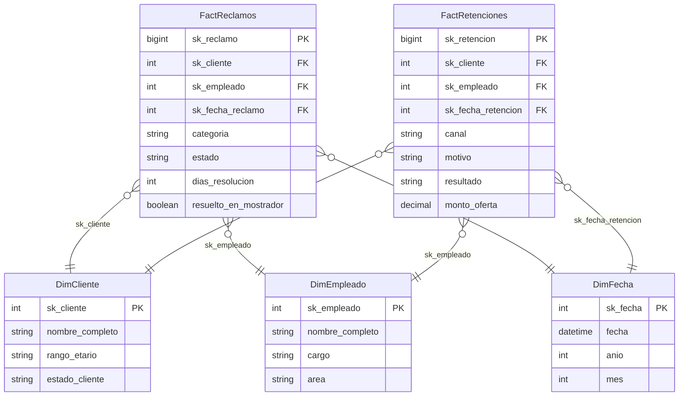
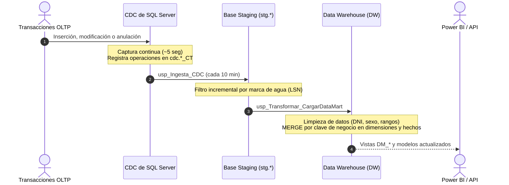

# VIP Center Fit — Business Intelligence & Data Warehouse Platform

[](https://www.microsoft.com/sql-server)
[](https://dotnet.microsoft.com/)
[](https://www.prisma.io/)
[](https://powerbi.microsoft.com/)
[](https://www.docker.com/)
[-blue)](#)

> **Plataforma analítica y ecosistema de Business Intelligence empresarial para la gestión estratégica, retención de socios y optimización operativa de cadenas de gimnasios y centros de acondicionamiento físico.**

---

## Índice

- [1. Visión y Propósito del Negocio](#1-visión-y-propósito-del-negocio)
  - [El Desafío de la Industria Fitness](#el-desafío-de-la-industria-fitness)
  - [Toma de Decisiones por Rol de Negocio](#toma-de-decisiones-por-rol-de-negocio)
- [2. Contexto Operativo y Flujo de Información](#2-contexto-operativo-y-flujo-de-información)
- [3. Arquitectura del Data Warehouse: Constelación Empresarial](#3-arquitectura-del-data-warehouse-constelación-empresarial)
- [4. Data Marts Especializados](#4-data-marts-especializados)
  - [4.1 Data Mart Comercial: Ventas, Membresías y Renovaciones](#41-data-mart-comercial-ventas-membresías-y-renovaciones)
  - [4.2 Data Mart Entrenamiento: Asistencia, Adherencia y Progreso](#42-data-mart-entrenamiento-asistencia-adherencia-y-progreso)
  - [4.3 Data Mart Atención: Experiencia, Reclamos y Retención](#43-data-mart-atención-experiencia-reclamos-y-retención)
- [5. Dimensiones Conformadas: La Columna Vertebral Analítica](#5-dimensiones-conformadas-la-columna-vertebral-analítica)
- [6. Matriz Bus del Negocio (Kimball)](#6-matriz-bus-del-negocio-kimball)
- [7. Gobierno, Calidad y Cadencia Operativa (CDC & ETL)](#7-gobierno-calidad-y-cadencia-operativa-cdc--etl)
- [8. Consumo de Información: Power BI y API Corporativa](#8-consumo-de-información-power-bi-y-api-corporativa)
- [9. Puesta en Marcha Rápida (Quickstart)](#9-puesta-en-marcha-rápida-quickstart)
- [10. Mapa de Navegación del Repositorio](#10-mapa-de-navegación-del-repositorio)

---

## 1. Visión y Propósito del Negocio

**VIP Center Fit** es una plataforma de analítica empresarial diseñada para transformar los datos operativos de una cadena de gimnasios en **decisiones estratégicas de alto impacto**. 

En lugar de limitarse a almacenar transacciones, el sistema modela el **ciclo de vida completo del cliente (Customer Lifetime Journey)** para responder de forma anticipada a las problemáticas críticas del sector.

### El Desafío de la Industria Fitness

```
+---------------------------------------------------------------------------------------------------+
|  1. Abandono Prematuro (Churn)    --> El 50% de los socios deja el gimnasio en los primeros 90 días |
|  2. Pérdida de Renovaciones       --> Avisos tardíos provocan fuga de ingresos recurrentes        |
|  3. Deserción por Falta de Metas  --> Clientes sin seguimiento antropométrico pierden motivación  |
|  4. Fricción en el Mostrador      --> Reclamos no resueltos en primera instancia erosionan la marca|
+---------------------------------------------------------------------------------------------------+
```

### Toma de Decisiones por Rol de Negocio

El modelo de datos y las métricas están estructurados en función de las necesidades específicas de los líderes de la organización:

| Actor / Rol | Preguntas Clave de Negocio | Impacto en la Operación |
| :--- | :--- | :--- |
| **Gerencia General** | ¿Cuál es la tasa neta de crecimiento de ingresos frente al período anterior? ¿Qué porcentaje de la cohorte activa continúa vigente? | Sostenibilidad financiera, proyección de ingresos recurrentes y control de fugas (*churn*). |
| **Jefatura Comercial** | ¿Qué planes y promociones generan mayor volumen y rentabilidad? ¿Cuál es la tasa de cobertura de avisos antes del vencimiento? | Optimización del catálogo de servicios y efectividad en campañas de renovación preventiva. |
| **Coordinación de Entrenamiento** | ¿Qué clientes presentan baja adherencia a sus sesiones? ¿Se están realizando las evaluaciones físicas a tiempo? | Intervención temprana para evitar que el cliente desista por estancamiento físico. |
| **Recepción y Atención al Cliente** | ¿Qué porcentaje de reclamos se resuelven de forma inmediata en mostrador? ¿Cuál es el éxito de las ofertas de rescate? | Retención en el punto de contacto presencial y mejora de la satisfacción del socio. |

---

## 2. Contexto Operativo y Flujo de Información

El ecosistema integra la actividad presencial del gimnasio con un pipeline automatizado de ingesta, refinamiento y explotación analítica:



---

## 3. Arquitectura del Data Warehouse: Constelación Empresarial

En lugar de aislar la información en silos departamentales, VIP Center Fit implementa una **Arquitectura en Constelación (Kimball Bus Architecture)**. 

Bajo este modelo, los tres Data Marts departamentales operan como esquemas relacionales independientes dentro de la misma base corporativa (`BI_VIP_CENTER_FIT_DW`), compartiendo un conjunto unificado de **Dimensiones Conformadas (`dim`)**.



> [!NOTE]
> **Consistencia Analítica Garantizada:** Al compartir dimensiones conformadas, el negocio puede correlacionar, por ejemplo, los clientes que renuevan membresías en `dm_comercial` con su frecuencia de asistencia en `dm_entrenamiento` y su historial de reclamos en `dm_atencion`.

---

## 4. Data Marts Especializados

Cada Data Mart aborda un dominio funcional autónomo del negocio, modelado en esquema estrella con claves foráneas físicas hacia las dimensiones conformadas.

---

### 4.1 Data Mart Comercial: Ventas, Membresías y Renovaciones

* **Esquema:** `dm_comercial`
* **Objetivo de Negocio:** Monitorear el flujo de ingresos, anticipar vencimientos de contratos y medir la conversión de promociones para maximizar el valor de vida del cliente (*Lifetime Value*).



#### Descripción de Tablas de Hechos (Facts)

| Tabla de Hechos | Concepto de Negocio | Granularidad | Indicadores Clave (KPIs) |
| :--- | :--- | :--- | :--- |
| **`FactVentas`** | Transacciones monetarias cobradas en caja o pasarela virtual. | Un registro por pago/cobro confirmado. | Ingresos totales, ticket promedio, descuento otorgado por campaña, desglose por medio de pago. |
| **`FactMembresias`** | Contratos de afiliación emitidos con sus fechas de vigencia. | Un registro por contrato de membresía. | Membresías activas, tasa de vencimiento mensual, penetración de planes anuales vs. mensuales. |
| **`FactRenovaciones`** | Recontrataciones comerciales de clientes recurrentes. | Un registro por evento de renovación concretada. | Tasa de renovación de membresías, ventana promedio de días de anticipación antes de expirar. |
| **`FactAvisos`** | Notificaciones preventivas enviadas al socio antes del vencimiento. | Un registro por aviso emitido (WhatsApp, SMS, Correo). | Tasa de cobertura de avisos (notificados vs. por vencer), efectividad de contacto por canal. |

---

### 4.2 Data Mart Entrenamiento: Asistencia, Adherencia y Progreso

* **Esquema:** `dm_entrenamiento`
* **Objetivo de Negocio:** Supervisar la calidad del servicio técnico-deportivo, detectando tempranamente socios en riesgo de abandono y garantizando el cumplimiento de evaluaciones biométricas.



#### Descripción de Tablas de Hechos (Facts)

| Tabla de Hechos | Concepto de Negocio | Granularidad | Indicadores Clave (KPIs) |
| :--- | :--- | :--- | :--- |
| **`FactAsistencias`** | Registro de ingresos reales al club y franjas horarias de entrenamiento. | Un registro por marcación de acceso por torniquete. | Aforo por hora, frecuencia semanal promedio por cliente, ocupación de sedes. |
| **`FactSesionesProgramadas`** | Clases grupales o sesiones con entrenador personal agendadas. | Un registro por sesión reservada. | Tasa de asistencia a clases programadas, ausentismo (*no-show*), demanda de entrenadores. |
| **`FactObjetivos`** | Metas deportivas fijadas (pérdida de peso, aumento de masa magra, etc.). | Un registro por objetivo formalizado. | Porcentaje de avance hacia la meta, detección de clientes con bajo progreso o estancamiento. |
| **`FactEvaluaciones`** | Mediciones físicas realizadas (peso, porcentaje de grasa, masa muscular). | Un registro por evaluación biométrica completada. | Variación de composición corporal en el tiempo, efectividad de rutinas por entrenador. |
| **`FactEvaluacionesProgramadas`** | Control del protocolo de seguimiento periódico pactado con el socio. | Un registro por cita de evaluación agendada. | Cumplimiento del calendario de chequeos físicos exigibles vs. evaluaciones pendientes. |

---

### 4.3 Data Mart Atención: Experiencia, Reclamos y Retención

* **Esquema:** `dm_atencion`
* **Objetivo de Negocio:** Medir la fricción en la experiencia del cliente y la efectividad del equipo de mostrador para resolver quejas y rescatar cancelaciones inminentes.



#### Descripción de Tablas de Hechos (Facts)

| Tabla de Hechos | Concepto de Negocio | Granularidad | Indicadores Clave (KPIs) |
| :--- | :--- | :--- | :--- |
| **`FactReclamos`** | Incidencias sobre infraestructura, máquinas, limpieza o atención. | Un registro por reclamo ingresado. | Tasa de resolución directa en mostrador (primer contacto), tiempo promedio de resolución (días), quejas por categoría. |
| **`FactRetenciones`** | Intervenciones formales para evitar la baja de un socio insatisfecho. | Un registro por acción de retención ejecutada. | Tasa de éxito de retención en mostrador, motivos principales de deserción, impacto del monto de contraoferta. |

---

## 5. Dimensiones Conformadas: La Columna Vertebral Analítica

El esquema compartido `dim` contiene los maestros del negocio, enriquecidos y estandarizados para análisis transversal:

```
                  +----------------------------------------------+
                  |               dim.DimCliente                 |
                  |  Maestro único de socios (SCD Tipo 2)        |
                  |  Histórico, segmentación etaria y demografía |
                  +----------------------------------------------+
                                         |
     +-----------------------------------+-----------------------------------+
     |                                   |                                   |
     v                                   v                                   v
+------------------------+  +------------------------+  +------------------------+
|    dim.DimEmpleado     |  |      dim.DimFecha      |  |      dim.DimPlan       |
|  Colaboradores, áreas  |  |  Jerarquía temporal    |  |  Catálogo de planes,   |
|  y cargos (ventas/gym) |  |  año, mes, día, festivo|  |  duración y precios    |
+------------------------+  +------------------------+  +------------------------+
                                         |
                                         v
                            +------------------------+
                            |    dim.DimPromocion    |
                            |  Estrategias de precio |
                            |  y descuentos vigentes |
                            +------------------------+
```

* **`DimCliente` (Slowly Changing Dimension Tipo 2):** Registra cambios en el estado y atributos del cliente conservando el histórico mediante marcas de validez (`fecha_inicio_validez`, `fecha_fin_validez`, `es_actual`).
* **`DimEmpleado`:** Representa a los entrenadores, cajeros y personal de recepción para evaluar desempeño por colaborador y área.
* **`DimFecha`:** Calendario con atributos de negocio precalculados (año, trimestre, mes, día de semana, indicador de fin de semana) para análisis de estacionalidad.
* **`DimPlan`:** Cataloga los paquetes de membresía por categoría de duración (mensual, trimestral, semestral, anual).
* **`DimPromocion`:** Permite aislar el impacto de campañas de marketing y descuentos porcentuales o de monto fijo sobre las ventas.

---

## 6. Matriz Bus del Negocio (Kimball)

La siguiente matriz evidencia la consistencia de la arquitectura: cada proceso de negocio (hecho) se vincula armónicamente con las dimensiones conformadas:

| Data Mart | Hecho / Proceso de Negocio | DimCliente | DimEmpleado | DimFecha | DimPlan | DimPromocion |
| :--- | :--- | :---: | :---: | :---: | :---: | :---: |
| **Comercial** | `FactVentas` | 🟢 | 🟢 | 🟢 | 🟢 | 🟢 |
| **Comercial** | `FactMembresias` | 🟢 | 🟢 | 🟢 | 🟢 | 🟢 |
| **Comercial** | `FactRenovaciones` | 🟢 | 🟢 | 🟢 | ⚪ | ⚪ |
| **Comercial** | `FactAvisos` | 🟢 | 🟢 | 🟢 | ⚪ | ⚪ |
| **Entrenamiento** | `FactAsistencias` | 🟢 | 🟢 | 🟢 | 🟢 | ⚪ |
| **Entrenamiento** | `FactSesionesProgramadas` | 🟢 | 🟢 | 🟢 | 🟢 | ⚪ |
| **Entrenamiento** | `FactObjetivos` | 🟢 | ⚪ | 🟢 | ⚪ | ⚪ |
| **Entrenamiento** | `FactEvaluaciones` | 🟢 | 🟢 | 🟢 | ⚪ | ⚪ |
| **Entrenamiento** | `FactEvaluacionesProgramadas` | 🟢 | 🟢 | 🟢 | ⚪ | ⚪ |
| **Atención** | `FactReclamos` | 🟢 | 🟢 | 🟢 | ⚪ | ⚪ |
| **Atención** | `FactRetenciones` | 🟢 | 🟢 | 🟢 | ⚪ | ⚪ |

*Leyenda: 🟢 Dimensión aplicada · ⚪ No aplicable al proceso.*

---

## 7. Gobierno, Calidad y Cadencia Operativa (CDC & ETL)

La integridad de los datos se gestiona mediante un flujo continuo en tres etapas dentro del motor SQL Server 2022:



### Reglas de Calidad y Seguridad de Acceso

1. **Garantía de Calidad:**
   * Estandarización de formato en identificadores (DNI), campos de sexo y fechas.
   * Reglas de negocio para descartar registros corruptos o fuera de rango.
   * Operaciones `MERGE` idempotentes que evitan duplicidad en recargas.
2. **Perfiles de Seguridad de Menor Privilegio:**
   * `api_writer`: Exclusivo para escritura en la base de origen (`ORIGEN`).
   * `etl_runner`: Permisos de ejecución de procedimientos almacenados de transformación.
   * `pbi_lector`: Acceso estrictamente de solo lectura (`SELECT`) a las vistas `dbo.DM_*` y dimensiones del Data Warehouse.

---

## 8. Consumo de Información: Power BI y API Corporativa

El Data Warehouse publica **13 vistas consolidadas (`dbo.DM_*`)** que desacoplan las fórmulas complejas del consumidor final.

```
                    +------------------------------------+
                    |   Vistas Consolidadas (dbo.DM_*)   |
                    |   13 Vistas con Métricas Oficiales |
                    +------------------------------------+
                                      |
                 +--------------------+--------------------+
                 |                                         |
                 v                                         v
   +----------------------------+            +----------------------------+
   |   Power BI (Direct/Import) |            |    API REST / OData .NET 8 |
   |   • Login seguro:          |            |    • Endpoints por rol     |
   |     pbi_lector             |            |    • OData: /odata/DM_*    |
   |   • Modelado DAX & Dashboards           |    • Health: /health       |
   +----------------------------+            +----------------------------+
```

### Catálogo de Vistas de Indicadores

| Área | Vista Analítica | Métrica Principal / Propósito |
| :--- | :--- | :--- |
| **Gerencia** | `dbo.DM_Gerencia_Ingresos` | Ingresos del período actual vs. anterior y tasa de crecimiento. |
| **Gerencia** | `dbo.DM_Gerencia_Membresias` | Clientes activos iniciales vs. finales, retención y renovaciones de cohorte. |
| **Comercial** | `dbo.DM_Comercial_Plan` | Ingresos y membresías vendidas/renovadas agrupadas por plan y promoción. |
| **Comercial** | `dbo.DM_Avisos_Cobertura` | Cobertura de notificaciones preventivas y membresías próximas a vencer. |
| **Entrenamiento**| `dbo.DM_Entrenamiento_Asistencia` | Tasa de asistencia por cliente y adherencia a sesiones. |
| **Entrenamiento**| `dbo.DM_Entrenamiento_Progreso` | Porcentaje de avance de objetivos corporales y detección de clientes estancados. |
| **Entrenamiento**| `dbo.DM_Entrenamiento_Evaluaciones`| Evaluaciones físicas exigibles vs. completadas y pendientes. |
| **Atención** | `dbo.DM_Atencion_Reclamos` | Tasa de resolución general y **resolución directa en mostrador**. |
| **Atención** | `dbo.DM_Atencion_Recepcion` | Tasa de éxito de retención en mostrador y motivos de posible baja. |

> [!TIP]
> La correspondencia detallada entre cada celda del requerimiento corporativo y las vistas SQL se encuentra en [`docs/OFICIAL1_CUMPLIMIENTO.md`](docs/OFICIAL1_CUMPLIMIENTO.md).

---

## 9. Puesta en Marcha Rápida (Quickstart)

### Requisitos Previos
* Docker y Docker Compose
* Node.js 20+ y npm
* .NET SDK 8.0 (opcional, para desarrollo local de la API)

### Pasos de Despliegue

```bash
# 1. Clonar el repositorio e instalar herramientas de introspección
git clone https://github.com/tu-organizacion/vip-center-fit-bi.git
cd vip-center-fit-bi
npm install

# 2. Configurar variables de entorno
cp .env.example .env

# 3. Levantar SQL Server 2022 y ejecutar el aprovisionamiento completo
# (Crea las 3 bases, habilita CDC, compila procedimientos y agenda el job de 10 min)
npm run db:bootstrap

# 4. Generar diagramas ER y modelos Prisma
npm run uml
```

### Ejecución de la API y Servicios Complementarios

```bash
# Iniciar la API REST y OData (.NET 8) en contenedor Docker (puerto 5080)
docker compose up -d --build api

# Acceder a la documentación Swagger de la API
# URL: http://localhost:5080/swagger
```

---

## 10. Mapa de Navegación del Repositorio

Para profundizar en aspectos específicos de la plataforma, consulte la documentación dedicada:

| Documento | Contenido y Alcance Técnico |
| :--- | :--- |
| 📘 [`docs/ARQUITECTURA.md`](docs/ARQUITECTURA.md) | Blueprint de 7 capas del pipeline BI, diseño en constelación y cadencia operativa. |
| 📊 [`docs/OFICIAL1_CUMPLIMIENTO.md`](docs/OFICIAL1_CUMPLIMIENTO.md) | Matriz formal de cumplimiento entre indicadores del negocio y vistas/endpoints. |
| 🔌 [`docs/API.md`](docs/API.md) | Catálogo completo de endpoints REST, OData y monitoreo de lag del pipeline. |
| 🛠️ [`docs/OPERACION.md`](docs/OPERACION.md) | Runbook de operaciones: jobs de SQL Server Agent, políticas de backup y seguridad. |
| 📐 [`docs/ERD.md`](docs/ERD.md) | Diagrama entidad-relación completo generado desde Prisma para toda la constelación. |
| 📈 [`docs/ERD_dm_comercial.md`](docs/ERD_dm_comercial.md) | Diagrama ER enfocado exclusivamente en el Data Mart Comercial. |
| 🏋️ [`docs/ERD_dm_entrenamiento.md`](docs/ERD_dm_entrenamiento.md) | Diagrama ER enfocado exclusivamente en el Data Mart de Entrenamiento. |
| 🛎️ [`docs/ERD_dm_atencion.md`](docs/ERD_dm_atencion.md) | Diagrama ER enfocado exclusivamente en el Data Mart de Atención y Reclamos. |

---

*Diseñado y desarrollado para VIP Center Fit — Inteligencia de Datos aplicada al Alto Rendimiento.*
