# VIP Center Fit — Inteligencia de Negocio (BI) & Data Warehouse

[](https://www.microsoft.com/sql-server)
[](https://dotnet.microsoft.com/)
[](https://www.prisma.io/)
[](https://powerbi.microsoft.com/)
[](https://www.docker.com/)
[](#)

> **Plataforma analítica y ecosistema de Business Intelligence para la gestión estratégica, la
> retención de socios y la optimización operativa de cadenas de gimnasios.**
> Modela el **ciclo de vida completo del socio** y lo traduce en indicadores de negocio para
> cada área de la organización.

---

## Índice

- [1. Matriz Bus del Data Warehouse](#1-matriz-bus-del-data-warehouse)
- [2. El negocio: actores y decisiones](#2-el-negocio-actores-y-decisiones)
- [3. Data Marts por proceso de negocio](#3-data-marts-por-proceso-de-negocio)
  - [3.1 Comercial — ventas, membresías y renovaciones](#31-data-mart-comercial--ventas-membresías-y-renovaciones)
  - [3.2 Entrenamiento — asistencia, adherencia y progreso](#32-data-mart-entrenamiento--asistencia-adherencia-y-progreso)
  - [3.3 Atención — experiencia, reclamos y retención](#33-data-mart-atención--experiencia-reclamos-y-retención)
- [4. Dimensiones conformadas](#4-dimensiones-conformadas)
- [5. Indicadores: qué se mide](#5-indicadores-qué-se-mide)
- [6. Reglas de calidad de datos](#6-reglas-de-calidad-de-datos)
- [7. API para el frontend — por actor](#7-api-para-el-frontend--por-actor)
- [8. Flujo de la información](#8-flujo-de-la-información)
- [9. Puesta en marcha (Quickstart)](#9-puesta-en-marcha-quickstart)
- [10. Documentación del repositorio](#10-documentación-del-repositorio)

---

## 1. Matriz Bus del Data Warehouse

Siguiendo la **metodología Kimball (Bottom-Up)**, el Data Warehouse **no es una base monolítica**:
es la suma de **Data Marts temáticos por proceso de negocio** que comparten un conjunto único de
**Dimensiones Conformadas**. La *Matriz Bus* es el plano que garantiza que todos los data marts
hablen el mismo idioma y sean comparables entre sí.

**Dimensiones conformadas (esquema `dim`):** `DimFecha`, `DimCliente`, `DimEmpleado`, `DimPlan`.

| Data Mart | Proceso de negocio (tabla de hechos) | `DimFecha` | `DimCliente` | `DimEmpleado` | `DimPlan` |
| :--- | :--- | :---: | :---: | :---: | :---: |
| **Comercial** | Venta / cobro — `FactVentas` | ✅ | ✅ | ✅ | ✅ |
| **Comercial** | Contrato de membresía — `FactMembresias` | ✅ | ✅ | ✅ | ✅ |
| **Comercial** | Renovación — `FactRenovaciones` | ✅ | ✅ | ✅ | — |
| **Comercial** | Aviso de vencimiento — `FactAvisos` | ✅ | ✅ | ✅ | — |
| **Entrenamiento** | Asistencia / acceso — `FactAsistencias` | ✅ | ✅ | ✅ | ✅ |
| **Entrenamiento** | Sesión programada — `FactSesionesProgramadas` | ✅ | ✅ | ✅ | ✅ |
| **Entrenamiento** | Objetivo deportivo — `FactObjetivos` | ✅ | ✅ | — | — |
| **Entrenamiento** | Evaluación física — `FactEvaluaciones` | ✅ | ✅ | ✅ | — |
| **Entrenamiento** | Evaluación programada — `FactEvaluacionesProgramadas` | ✅ | ✅ | ✅ | — |
| **Atención** | Reclamo — `FactReclamos` | ✅ | ✅ | ✅ | — |
| **Atención** | Retención — `FactRetenciones` | ✅ | ✅ | ✅ | — |

*Leyenda: ✅ el proceso usa la dimensión · — no aplica.*

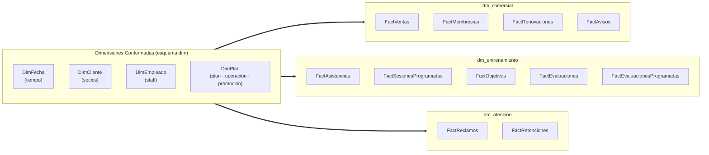

> **¿Por qué importa?** Al compartir dimensiones, el negocio puede cruzar datos de distintas áreas:
> por ejemplo, relacionar a los socios que **renuevan** (`dm_comercial`) con su **frecuencia de
> asistencia** (`dm_entrenamiento`) y su **historial de reclamos** (`dm_atencion`).

---

## 2. El negocio: actores y decisiones

VIP Center Fit transforma los datos operativos del gimnasio en decisiones. El modelo responde a las
problemáticas reales del sector: **abandono temprano (churn)**, **pérdida de renovaciones**,
**deserción por falta de metas** y **fricción en el mostrador**.

| Actor / Rol | Preguntas de negocio | Decisión que habilita |
| :--- | :--- | :--- |
| **Gerencia General** | ¿Cómo evolucionan los ingresos, las membresías activas y la retención? | Sostenibilidad financiera, proyección de ingresos recurrentes, control del *churn*. |
| **Jefatura Comercial** | ¿Qué planes y promociones rinden más? ¿Se avisa a tiempo antes del vencimiento? | Optimización del catálogo y de las campañas de renovación preventiva. |
| **Coordinación de Entrenamiento** | ¿Quiénes asisten poco, progresan poco o tienen evaluaciones pendientes? | Intervención temprana para evitar el abandono por estancamiento. |
| **Recepción y Atención** | ¿Se resuelven los reclamos en el mostrador? ¿Qué rescates de baja funcionan? | Retención en el punto de contacto y mejora de la satisfacción. |

---

## 3. Data Marts por proceso de negocio

Cada Data Mart es un **esquema estrella** con claves foráneas físicas hacia las dimensiones
conformadas. Por cada **tabla de hechos** se documenta su proceso, grano, dimensiones, indicadores
y su **diagrama estrella**.

### 3.1 Data Mart Comercial — ventas, membresías y renovaciones

* **Esquema:** `dm_comercial` · **Actor principal:** Administración y Jefatura Comercial.
* **Objetivo:** monitorear el flujo de ingresos, anticipar vencimientos y medir la conversión de
  promociones para maximizar el valor de vida del cliente (*Lifetime Value*).

#### Proceso: Venta / cobro en caja

* **Proceso de negocio:** cobro de planes y servicios en caja o pasarela virtual.
* **Grano:** un registro por **pago confirmado** (`id_pago_bk`).
* **Dimensiones:** Fecha (fecha de pago), Cliente, Empleado, Plan.
* **Indicadores:** ingresos, ticket promedio, descuento otorgado, mix por medio de pago.
* **Diagrama:**

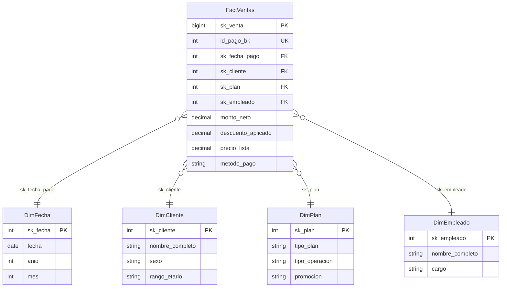

#### Proceso: Contrato de membresía

* **Proceso de negocio:** alta y vigencia de un contrato de afiliación.
* **Grano:** un registro por **contrato de membresía** (`id_membresia_bk`).
* **Dimensiones:** Fecha (inicio y fin), Cliente, Empleado, Plan.
* **Indicadores:** membresías activas, vencimientos del período, penetración por tipo de plan.
* **Diagrama:**

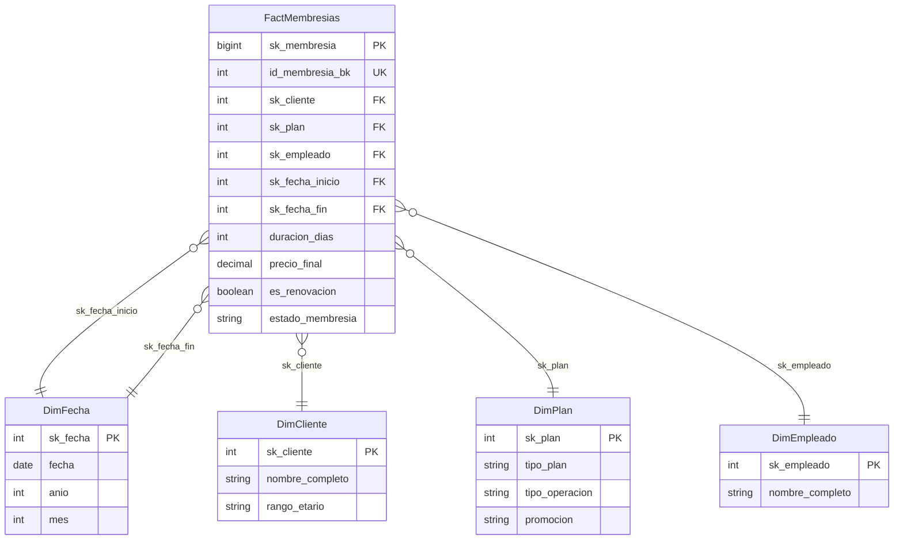

#### Proceso: Renovación de membresía

* **Proceso de negocio:** recontratación de un socio que vencía.
* **Grano:** un registro por **evento de renovación** (`id_renovacion_bk`).
* **Dimensiones:** Fecha (de renovación), Cliente, Empleado.
* **Indicadores:** tasa de renovación, días de anticipación promedio, monto renovado.
* **Diagrama:**

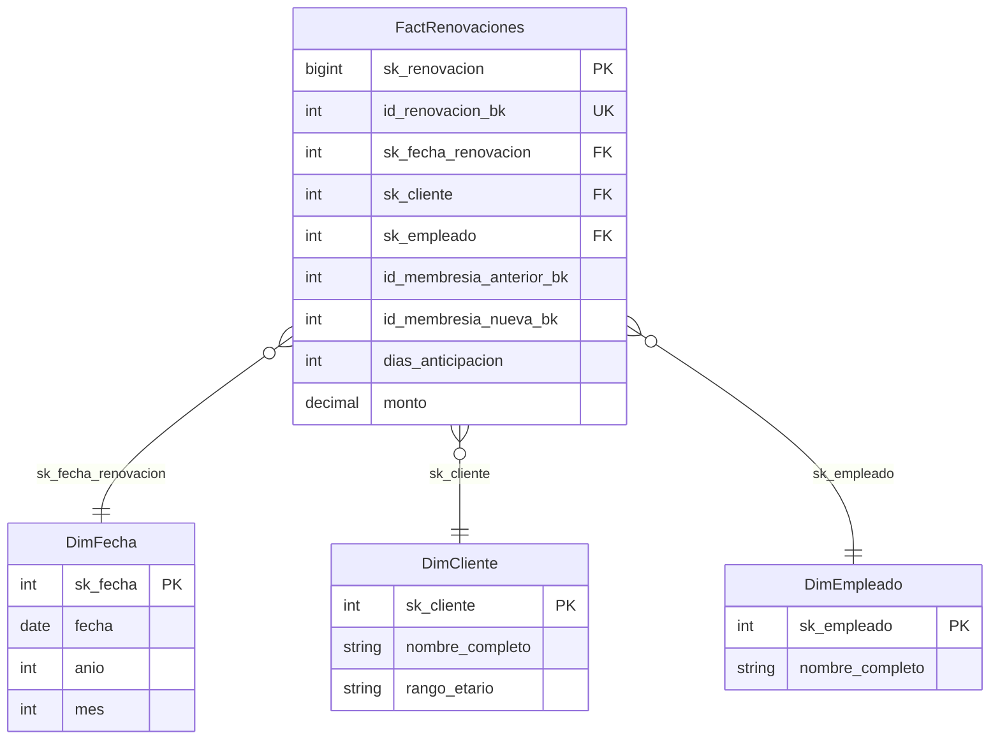

#### Proceso: Aviso preventivo de vencimiento

* **Proceso de negocio:** notificación al socio antes de que venza su membresía.
* **Grano:** un registro por **aviso emitido** (`id_aviso_bk`).
* **Dimensiones:** Fecha (del aviso), Cliente, Empleado.
* **Indicadores:** cobertura de avisos, efectividad por canal (WhatsApp/SMS/Correo).
* **Diagrama:**

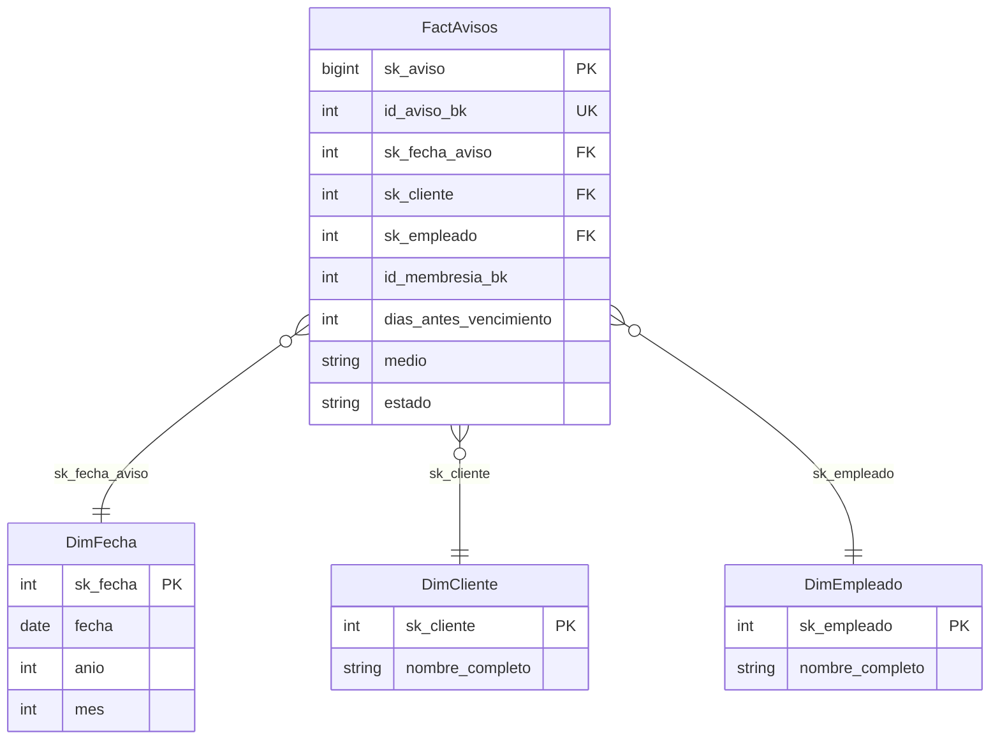

---

### 3.2 Data Mart Entrenamiento — asistencia, adherencia y progreso

* **Esquema:** `dm_entrenamiento` · **Actor principal:** Coordinación de Entrenamiento.
* **Objetivo:** detectar socios en riesgo de abandono y asegurar el cumplimiento del protocolo
  de evaluaciones físicas.

#### Proceso: Asistencia / control de acceso

* **Proceso de negocio:** ingresos reales al club (torniquete).
* **Grano:** un registro por **marcación de acceso** (`id_asistencia_bk`).
* **Dimensiones:** Fecha, Cliente, Plan, Empleado.
* **Indicadores:** aforo por hora, frecuencia semanal promedio, adherencia por cliente.
* **Diagrama:**

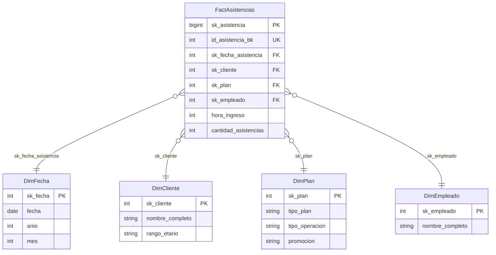

#### Proceso: Sesión programada (clases y entrenamiento personal)

* **Proceso de negocio:** reserva de clases grupales o sesiones con entrenador.
* **Grano:** un registro por **sesión programada** (`id_sesion_bk`).
* **Dimensiones:** Fecha, Cliente, Plan, Empleado.
* **Indicadores:** tasa de asistencia a clases, ausentismo (*no-show*), demanda por entrenador.
* **Diagrama:**

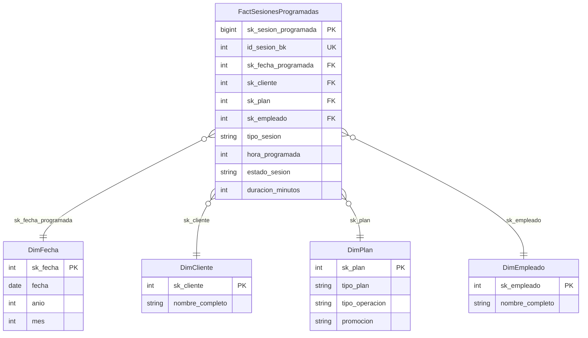

#### Proceso: Objetivo deportivo

* **Proceso de negocio:** meta física fijada con el socio (bajar grasa, ganar masa, etc.).
* **Grano:** un registro por **objetivo formalizado** (`id_objetivo_bk`).
* **Dimensiones:** Fecha (inicio), Cliente.
* **Indicadores:** avance vs. meta, detección de bajo progreso / estancamiento.
* **Diagrama:**

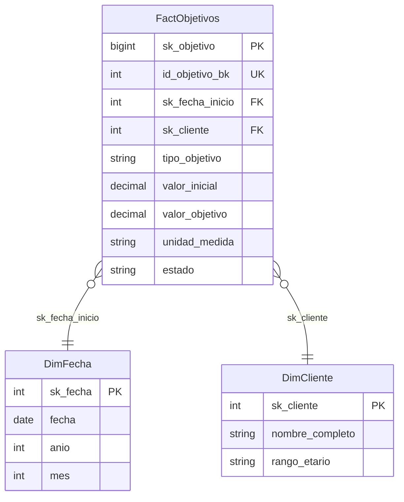

#### Proceso: Evaluación física (antropometría)

* **Proceso de negocio:** medición biométrica del socio (peso, grasa, masa muscular).
* **Grano:** un registro por **evaluación realizada** (`id_evaluacion_bk`).
* **Dimensiones:** Fecha, Cliente, Empleado.
* **Indicadores:** variación de composición corporal, efectividad por entrenador.
* **Diagrama:**

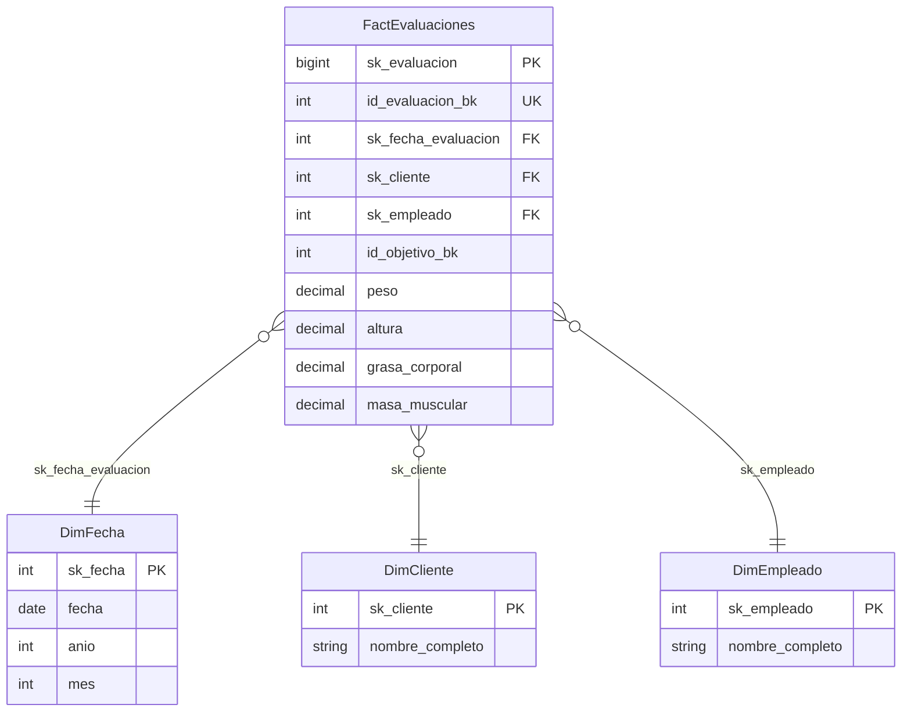

#### Proceso: Evaluación programada (protocolo de seguimiento)

* **Proceso de negocio:** cita de evaluación pactada con el socio (exigible vs. realizada).
* **Grano:** un registro por **evaluación programada** (`id_evaluacion_programada_bk`).
* **Dimensiones:** Fecha, Cliente, Empleado.
* **Indicadores:** evaluaciones exigibles, completadas y pendientes; cumplimiento del protocolo.
* **Diagrama:**

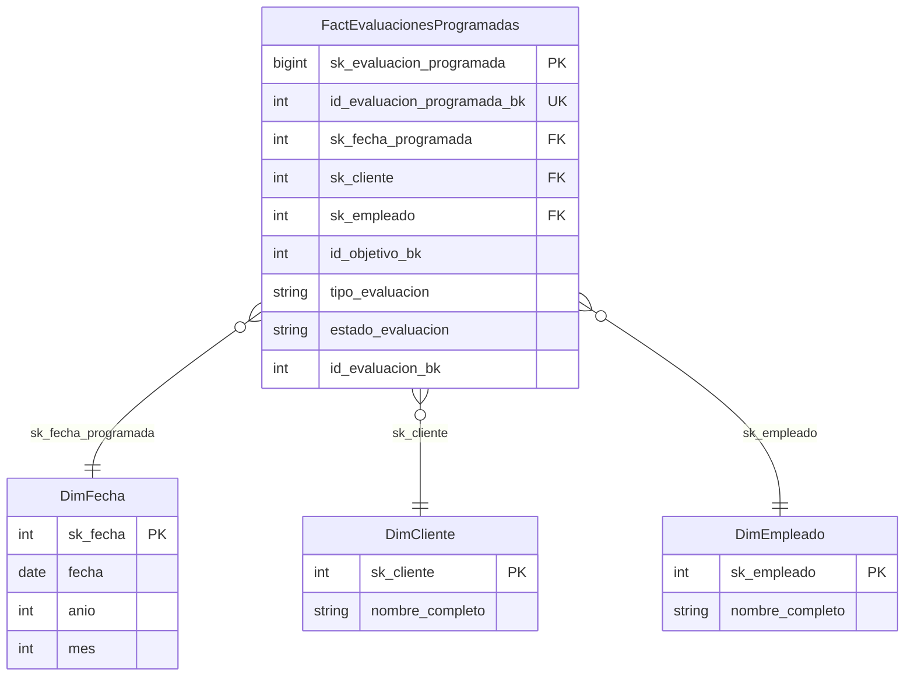

---

### 3.3 Data Mart Atención — experiencia, reclamos y retención

* **Esquema:** `dm_atencion` · **Actor principal:** Recepción.
* **Objetivo:** medir la fricción en la experiencia del socio y la efectividad del mostrador para
  resolver quejas y rescatar cancelaciones inminentes.

#### Proceso: Reclamo en mostrador

* **Proceso de negocio:** incidencia sobre infraestructura, máquinas, limpieza o atención.
* **Grano:** un registro por **reclamo ingresado** (`id_reclamo_bk`).
* **Dimensiones:** Fecha (del reclamo), Cliente, Empleado.
* **Indicadores:** tasa de resolución, resolución directa en mostrador, días promedio de resolución.
* **Diagrama:**

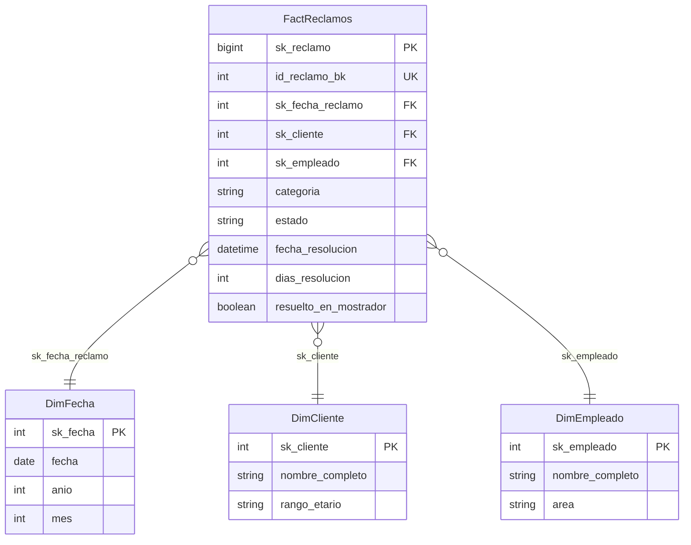

#### Proceso: Acción de retención / rescate

* **Proceso de negocio:** intervención para evitar la baja de un socio insatisfecho.
* **Grano:** un registro por **acción de retención ejecutada** (`id_retencion_bk`).
* **Dimensiones:** Fecha (de la acción), Cliente, Empleado.
* **Indicadores:** tasa de éxito de retención, motivos de baja, impacto del monto de contraoferta.
* **Diagrama:**

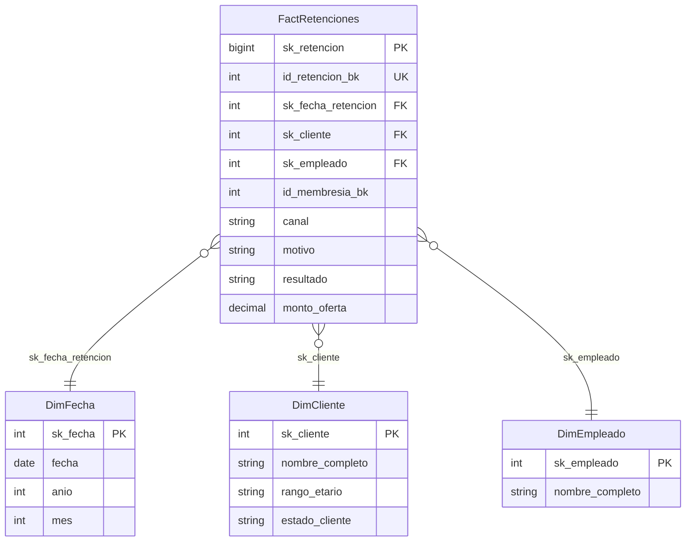

---

## 4. Dimensiones conformadas

Son los maestros del negocio, enriquecidos y estandarizados, que **comparten los tres data marts**.
Viven en el esquema `dim`.

| Dimensión | Qué representa | Atributos de análisis |
| :--- | :--- | :--- |
| **`DimFecha`** | Calendario y estacionalidad. | año, trimestre, semestre, mes, día, día de semana, fin de semana. |
| **`DimCliente`** | Maestro único de socios (persona). **SCD Tipo 1** (sin historial; conserva marcas de validez del origen). | nombre, sexo, rango etario, estado (activo/inactivo). |
| **`DimEmpleado`** | Personal (ventas, recepción, entrenadores). | nombre, cargo (puesto), área. |
| **`DimPlan`** | Plan, operación y promoción. | **tipo de plan** (mensual, trimestral, semestral, anual, quinquenal, por un día), **tipo de operación** (venta, membresía, renovación, aviso, reclamo, retención, asistencia, sesión) y **promoción**. |

* **`DimCliente`** es **SCD Tipo 1**: una sola fila por socio; un cambio de estado o rango etario
  sobrescribe la fila (no versiona historial).
* **`DimPlan`** unifica en una sola dimensión las tres propuestas originales (tipo de plan, tipo de
  operación y promoción); absorbe el antiguo catálogo de promociones, que no calificaba como
  dimensión propia.
* **Miembros centinela (`-1`)** e **imputación**: un hecho que no resuelve su dimensión **no se
  descarta**; se imputa al miembro centinela (`CLIENTE NO IDENTIFICADO`, `SIN EMPLEADO`, etc.) y se
  registra la alerta en `dq.RegistroImputaciones` (ver [`docs/CALIDAD.md`](docs/CALIDAD.md)). Las FK
  de hechos nunca quedan `NULL`.

---

## 5. Indicadores: qué se mide

El DW publica **16 vistas** `dbo.DM_*` que desacoplan las fórmulas del consumidor final (Power BI
o API). Cada vista corresponde a las preguntas de negocio de un área.

| Área | Vista | Qué responde |
| :--- | :--- | :--- |
| **Gerencia** | `DM_Gerencia_Ingresos` | Ingresos del período actual vs. anterior y tasa de crecimiento. |
| **Gerencia** | `DM_Gerencia_Membresias` | Clientes activos, retención y renovación de cohortes. |
| **Gerencia** | `DM_Ventas_Gerencia` | Ingresos y ventas por trimestre y tipo de plan. |
| **Comercial** | `DM_Comercial_Plan` | Ingresos y membresías por tipo de plan (y su tasa de renovación). |
| **Comercial** | `DM_Avisos_Cobertura` | Cobertura de avisos preventivos (ventana 7 días). |
| **Comercial** | `DM_Promociones_Ventas` | Ingresos, ventas y descuento otorgado por promoción. |
| **Comercial** | `DM_Promociones_Membresias` | Membresías vendidas y renovadas por promoción y empleado. |
| **Comercial** | `DM_Promociones_Clientes` | Clientes captados por promoción y segmento. |
| **Entrenamiento** | `DM_Entrenamiento_Asistencia` | Tasa de asistencia por cliente y adherencia a sesiones. |
| **Entrenamiento** | `DM_Entrenamiento_Progreso` | Porcentaje de avance de objetivos y clientes estancados. |
| **Entrenamiento** | `DM_Entrenamiento_Cumplimiento` | Cumplimiento agregado de objetivos por período. |
| **Entrenamiento** | `DM_Entrenamiento_Evaluaciones` | Evaluaciones exigibles vs. completadas y pendientes. |
| **Entrenamiento** | `DM_Rutinas_Entrenador` | Asistencias por entrenador, rango etario y tipo de plan. |
| **Atención** | `DM_Atencion_Reclamos` | Resolución general y **resolución directa en mostrador**. |
| **Atención** | `DM_Atencion_Recepcion` | Atenciones por sexo, rango etario y categoría. |
| **Atención** | `DM_Atencion_Retencion` | Éxito de retención en mostrador y motivos de posible baja. |

> La trazabilidad de cada indicador contra el requerimiento corporativo está en
> [`docs/OFICIAL1_CUMPLIMIENTO.md`](docs/OFICIAL1_CUMPLIMIENTO.md).

---

## 6. Reglas de calidad de datos

Los datos operativos llegan "crudos" (con defectos a propósito). Antes de cargarse al DW, cada fila
pasa por **reglas de calidad**. El catálogo completo está en [`docs/CALIDAD.md`](docs/CALIDAD.md);
la auditoría ejecutable, en `sql/12_reglas_calidad.sql`.

**Corrección y estandarización** (el proceso limpia y normaliza; no descarta):

| Regla | Qué corrige |
| :--- | :--- |
| CAL-01/02 | DNI (formato a 8 dígitos) y nombre (mayúsculas, sin espacios dobles). |
| CAL-03/04 | Sexo → `M/F/X`; estado del cliente → `ACTIVO/INACTIVO`. |
| CAL-05/06 | Medio de pago a catálogo; montos negativos → `0`/`NULL`. |
| CAL-07/08 | Fechas de cliente fuera de rango o inválidas → `NULL`. |
| CAL-09 | Estado de membresía **recalculado** según la fecha de corte. |
| CAL-10/11 | Horas de ingreso y antropometría (unidades y rangos). |
| CAL-12/13 | Catálogos de reclamos, retenciones, objetivos, sesiones y planes. |

**Imputación auditada** (el hecho **siempre entra**; se imputa al centinela `-1` y queda registrado
en `dq.RegistroImputaciones`): filas que **no resuelven su cliente o su fecha** (reglas IMP-*). Así
no se pierde dinero y cada imputación es auditable con la vista `dq.V_ImputacionesPorRegla`.

---

## 7. API para el frontend — por actor

La API (.NET 8) expone los indicadores del DW por **REST**, un **dashboard agregado por actor**
(una sola llamada con todo lo que ese rol necesita) y **OData** para Power BI. Swagger: `/swagger`.

### Dashboards por actor (una llamada, ideal para el frontend)

| Actor | Endpoint | Contenido |
| :--- | :--- | :--- |
| **Gerencia General** | `GET /api/v1/actores/gerencia/dashboard` | Crecimiento y retención: ingresos, membresías, ventas. |
| **Jefatura Comercial** | `GET /api/v1/actores/comercial/dashboard` | Planes y promociones, cobertura de avisos. |
| **Coordinación de Entrenamiento** | `GET /api/v1/actores/entrenador/dashboard` | Asistencia, progreso, cumplimiento, rutinas, evaluaciones. |
| **Recepción** | `GET /api/v1/actores/recepcion/dashboard` | Reclamos, atención y retención. |

### Indicadores por área (REST)

| Actor | Endpoints |
| :--- | :--- |
| **Gerencia** | `/kpis/gerencia/ingresos`, `/kpis/gerencia/membresias`, `/kpis/ventas` |
| **Comercial** | `/kpis/comercial/planes`, `/kpis/comercial/avisos-cobertura`, `/kpis/comercial/promociones/ventas`, `/kpis/comercial/promociones/membresias`, `/kpis/comercial/promociones/clientes` |
| **Entrenamiento** | `/kpis/entrenamiento/asistencia`, `/progreso`, `/cumplimiento`, `/evaluaciones`, `/rutinas` |
| **Recepción** | `/kpis/atencion/reclamos`, `/kpis/atencion/recepcion`, `/kpis/atencion/retencion` |

> Prefijo `/api/v1`. Filtros por querystring: `desde`/`hasta` (año), `plan`, `categoria`,
> `skCliente`, `tipoObjetivo`, `entrenador`, `canal`.

### Escritura (operación del gimnasio)

`POST /api/v1/{clientes, empleados, membresias, ventas, renovaciones, avisos, asistencias,
objetivos, evaluaciones, reclamos, sesiones-programadas, evaluaciones-programadas, retenciones}` —
simulan la web del gimnasio; cada cambio lo captura CDC.

### OData (Power BI) y monitoreo

* `/odata/DM_*` con `$select`, `$filter`, `$orderby`, `$top`, `$count` (un *entity set* por vista, incluyendo `DM_Promociones_Ventas`, `DM_Promociones_Membresias` y `DM_Promociones_Clientes`).
* `GET /api/v1/etl/estado` — estado del pipeline (marca de agua CDC + ETL).
* `GET /health` — salud del servicio.

> Catálogo detallado de endpoints y ejemplos en [`docs/API.md`](docs/API.md).

---

## 8. Flujo de la información

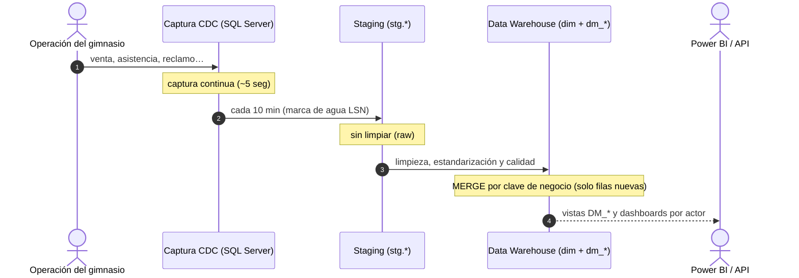

---

## 9. Puesta en marcha (Quickstart)

**Requisitos:** Docker + Docker Compose, Node.js 20+ y npm (.NET SDK 8 opcional para la API).

```bash
git clone https://github.com/tu-organizacion/vip-center-fit-bi.git
cd vip-center-fit-bi
npm install
cp .env.example .env

npm run db:bootstrap   # SQL Server + CDC + ETL inicial + vistas + reglas de calidad
npm run uml            # genera el ERD (Prisma + Mermaid)

docker compose up -d --build api   # API en http://localhost:5080 (Swagger en /swagger)
```

---

## 10. Documentación del repositorio

| Documento | Contenido |
| :--- | :--- |
| 📘 [`docs/ARQUITECTURA.md`](docs/ARQUITECTURA.md) | Blueprint de 7 etapas del pipeline y diseño en constelación. |
| 📊 [`docs/OFICIAL1_CUMPLIMIENTO.md`](docs/OFICIAL1_CUMPLIMIENTO.md) | Trazabilidad de cada indicador contra el requerimiento corporativo. |
| 🔌 [`docs/API.md`](docs/API.md) | Catálogo completo de endpoints REST/OData. |
| 🧪 [`docs/CALIDAD.md`](docs/CALIDAD.md) | Catálogo de reglas de calidad (corrección e imputación). |
| 🛠️ [`docs/OPERACION.md`](docs/OPERACION.md) | Runbook: jobs, backups y seguridad. |
| 📐 [`docs/ERD.md`](docs/ERD.md) | Diagrama entidad-relación de toda la constelación. |

---

*Diseñado y desarrollado para **VIP Center Fit** — Inteligencia de Datos aplicada al Alto Rendimiento.*
