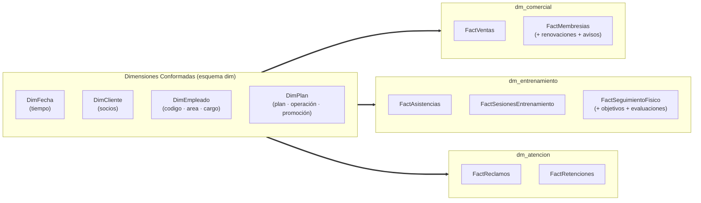
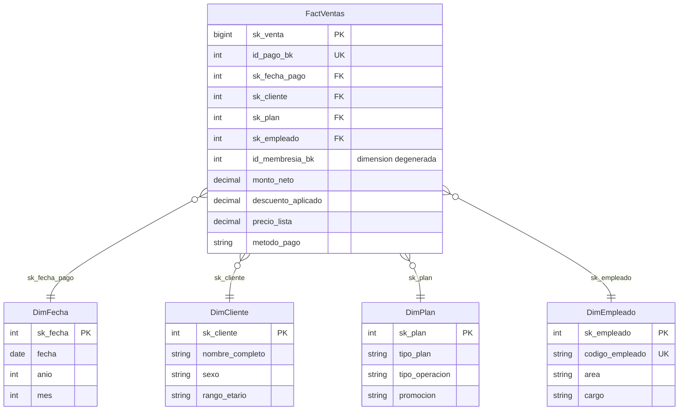
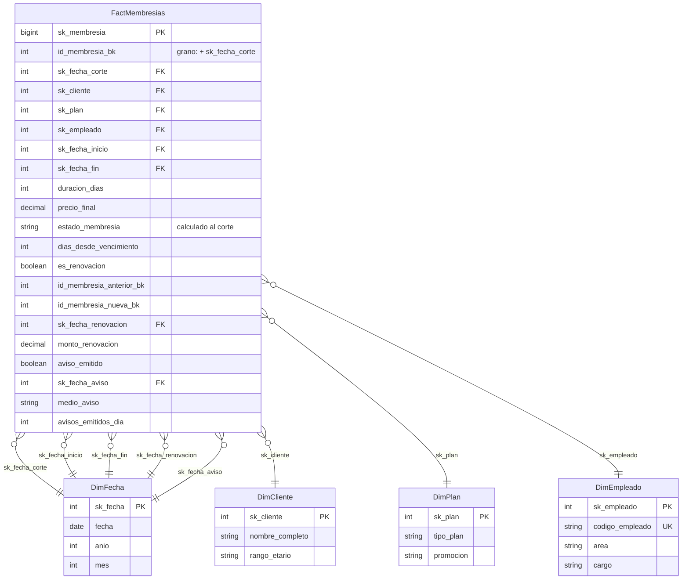
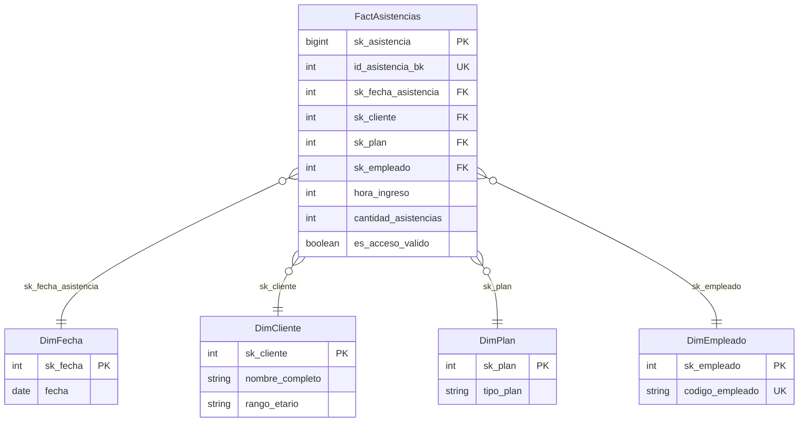
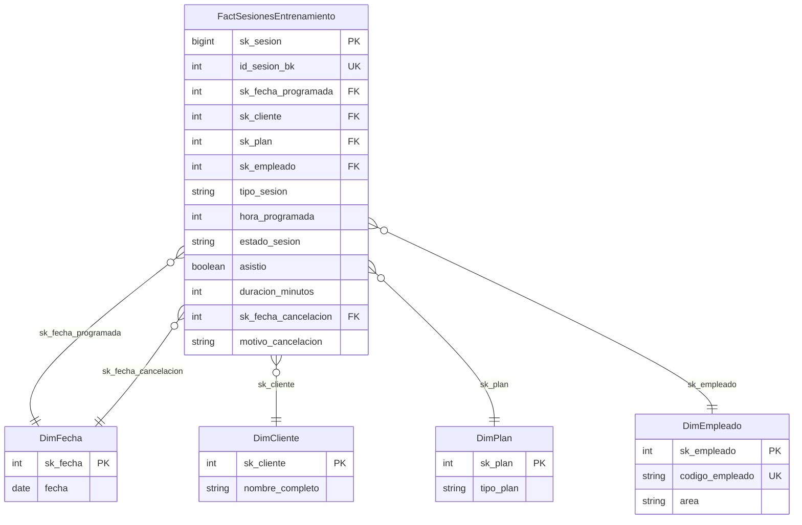
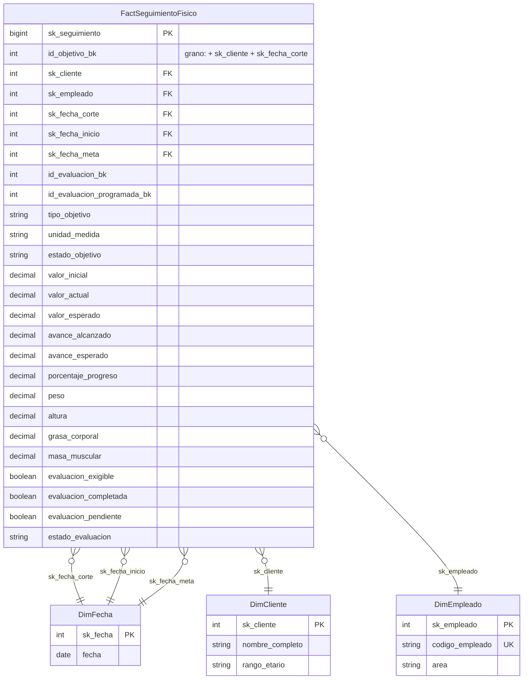
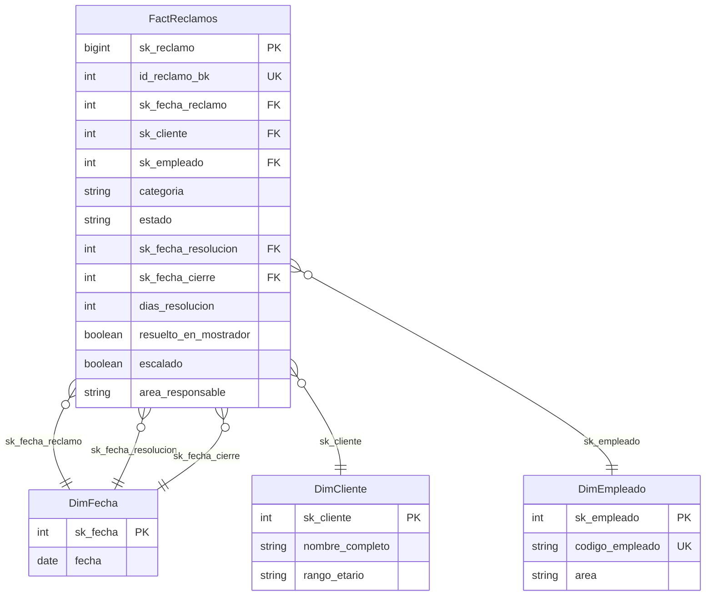
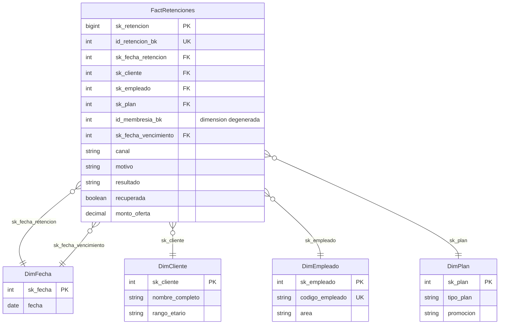
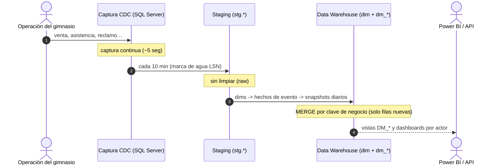

# VIP Center Fit — Inteligencia de Negocio (BI) & Data Warehouse

[](https://www.microsoft.com/sql-server)
[](https://dotnet.microsoft.com/)
[](https://www.prisma.io/)
[](https://powerbi.microsoft.com/)
[](https://www.docker.com/)
[](#)

> **Plataforma analítica y ecosistema de Business Intelligence para la gestión estratégica, la
> retención de socios y la optimización operativa de cadenas de gimnasios.**
> Modela el **ciclo de vida completo del socio** y lo traduce en indicadores de negocio para
> cada área de la organización.

---

## Índice

- [1. Matriz Bus del Data Warehouse](#1-matriz-bus-del-data-warehouse)
- [2. El negocio: actores y decisiones](#2-el-negocio-actores-y-decisiones)
- [3. Data Marts y los 7 hechos](#3-data-marts-y-los-7-hechos)
  - [3.1 Comercial — FactVentas y FactMembresias](#31-data-mart-comercial--dm_comercial)
  - [3.2 Entrenamiento — accesos, sesiones y progreso](#32-data-mart-entrenamiento--dm_entrenamiento)
  - [3.3 Atención — reclamos y retención](#33-data-mart-atencion--dm_atencion)
  - [3.4 Cómo funcionan los snapshots diarios](#34-cómo-funcionan-los-dos-snapshots-diarios)
  - [3.5 Qué se consolidó y dónde](#35-qué-se-consolidó-y-dónde)
- [4. Dimensiones conformadas](#4-dimensiones-conformadas)
- [5. Indicadores: qué se mide](#5-indicadores-qué-se-mide)
- [6. Reglas de calidad de datos](#6-reglas-de-calidad-de-datos)
- [7. API para el frontend — por actor](#7-api-para-el-frontend--por-actor)
- [8. Flujo de la información](#8-flujo-de-la-información)
- [9. Puesta en marcha (Quickstart)](#9-puesta-en-marcha-quickstart)
- [10. Documentación del repositorio](#10-documentación-del-repositorio)

---

## 1. Matriz Bus del Data Warehouse

Siguiendo la **metodología Kimball (Bottom-Up)**, el Data Warehouse **no es una base monolítica**:
es la suma de **Data Marts temáticos por proceso de negocio** que comparten un conjunto único de
**Dimensiones Conformadas**. La *Matriz Bus* es el plano que garantiza que todos los data marts
hablen el mismo idioma y sean comparables entre sí.

**Dimensiones conformadas (esquema `dim`):** `DimFecha`, `DimCliente`, `DimEmpleado`, `DimPlan`.
**Data marts (3):** `dm_comercial`, `dm_entrenamiento`, `dm_atencion`.
**Hechos (7):** dos comerciales, tres de entrenamiento y dos de atención.

| Data Mart | Hecho | Grano declarado | Fecha | Cliente | Empleado | Plan |
| :--- | :--- | :--- | :---: | :---: | :---: | :---: |
| **Comercial** | `FactVentas` | Un pago confirmado (`id_pago_bk`) | ✅ | ✅ | ✅ | ✅ |
| **Comercial** | `FactMembresias` | Una membresía en una fecha de corte (`id_membresia_bk` + `sk_fecha_corte`) | ✅ | ✅ | ✅ | ✅ |
| **Entrenamiento** | `FactAsistencias` | Una marcación real de acceso (`id_asistencia_bk`) | ✅ | ✅ | ✅ | ✅ |
| **Entrenamiento** | `FactSesionesEntrenamiento` | Una sesión programada (`id_sesion_bk`) | ✅ | ✅ | ✅ | ✅ |
| **Entrenamiento** | `FactSeguimientoFisico` | Un cliente, un objetivo y una fecha de corte (`sk_cliente` + `id_objetivo_bk` + `sk_fecha_corte`) | ✅ | ✅ | ✅ | — |
| **Atención** | `FactReclamos` | Un reclamo registrado (`id_reclamo_bk`) | ✅ | ✅ | ✅ | — |
| **Atención** | `FactRetenciones` | Una acción de retención (`id_retencion_bk`) | ✅ | ✅ | ✅ | ✅ |

*Leyenda: ✅ el proceso usa la dimensión · — no aplica.*

> **Consolidación (bloques M01/M02/M03 del requerimiento):**
> - **M01 Comercial:** `FactRenovaciones` y `FactAvisos` se **absorben** en `FactMembresias`.
>   Conservar `FactVentas` aparte mantiene la fecha, el importe y la atribución real del cobro.
> - **M02 Entrenamiento:** `FactObjetivos`, `FactEvaluaciones` y `FactEvaluacionesProgramadas`
>   se consolidan en `FactSeguimientoFisico`, sin perder el detalle de cada objetivo.
> - **M03 Atención:** reclamo y acción de retención siguen separados; unirlos por cliente
>   multiplicaría casos y resultados.



> **¿Por qué importa?** Al compartir dimensiones, el negocio puede cruzar datos de distintas áreas:
> por ejemplo, relacionar a los socios que **renuevan** (`dm_comercial`) con su **frecuencia de
> asistencia** (`dm_entrenamiento`) y su **historial de reclamos** (`dm_atencion`).

---

## 2. El negocio: actores y decisiones

VIP Center Fit transforma los datos operativos del gimnasio en decisiones. El modelo responde a las
problemáticas reales del sector: **abandono temprano (churn)**, **pérdida de renovaciones**,
**deserción por falta de metas** y **fricción en el mostrador**.

| Actor / Rol | Preguntas de negocio | Decisión que habilita |
| :--- | :--- | :--- |
| **Gerencia General** | ¿Cómo evolucionan los ingresos, las membresías activas y la retención? | Sostenibilidad financiera, proyección de ingresos recurrentes, control del *churn*. |
| **Jefatura Comercial** | ¿Qué planes y promociones rinden más? ¿Se avisa a tiempo antes del vencimiento? | Optimización del catálogo y de las campañas de renovación preventiva. |
| **Coordinación de Entrenamiento** | ¿Quiénes asisten poco, progresan poco o tienen evaluaciones pendientes? | Intervención temprana para evitar el abandono por estancamiento. |
| **Recepción y Atención** | ¿Se resuelven los reclamos en el mostrador? ¿Qué rescates de baja funcionan? | Retención en el punto de contacto y mejora de la satisfacción. |

---

## 3. Data Marts y los 7 hechos

Cada Data Mart es un **esquema estrella** con claves foráneas físicas hacia las dimensiones
conformadas. Por cada **tabla de hechos** se documenta su proceso de negocio, grano, dimensiones,
medidas, columnas y su **diagrama estrella**. El diagrama completo de la constelación está en
[`docs/ERD.md`](docs/ERD.md) (generado con Prisma).

| Data Mart | Hechos | Actor principal |
| :--- | :--- | :--- |
| `dm_comercial` | `FactVentas`, `FactMembresias` | Administración y Jefatura Comercial |
| `dm_entrenamiento` | `FactAsistencias`, `FactSesionesEntrenamiento`, `FactSeguimientoFisico` | Coordinación de Entrenamiento |
| `dm_atencion` | `FactReclamos`, `FactRetenciones` | Recepción |

---

### 3.1 Data Mart Comercial — `dm_comercial`

* **Esquema:** `dm_comercial` · **Actor principal:** Administración y Jefatura Comercial.
* **Objetivo:** monitorear el flujo de ingresos, anticipar vencimientos y medir la conversión de
  promociones para maximizar el valor de vida del cliente (*Lifetime Value*).

#### 3.1.1 Proceso: Venta / cobro en caja — `FactVentas`

* **Proceso de negocio:** cobro de planes y servicios en caja o pasarela virtual.
* **Grano:** un registro por **pago confirmado** (`id_pago_bk`).
* **Dimensiones:** Fecha (fecha de pago), Cliente, Empleado, Plan. `id_membresia_bk` es una
  **dimensión degenerada**: permite llegar al contrato sin duplicar el hecho por membresía.
* **Medidas aditivas:** `monto_neto`, `descuento_aplicado`, `precio_lista`.
* **Atributos de contexto:** `metodo_pago` (`YAPE/PLIN/TRANSFERENCIA/TARJETA/EFECTIVO/NO ESPECIFICADO`).
* **Indicadores:** ingresos del periodo, ticket promedio, descuento otorgado, mix por medio de pago.
* **Regla de negocio:** conservar los pagos como hecho aparte mantiene la **fecha real del cobro**,
  el importe y la atribución del vendedor; no se derivan de la membresía.
* **Diagrama:**



#### 3.1.2 Proceso: Contrato de membresía — `FactMembresias` (snapshot diario)

* **Proceso de negocio:** vigencia de un contrato de afiliación, su aviso preventivo y su renovación.
* **Grano:** **una membresía en una fecha de corte** (`id_membresia_bk` + `sk_fecha_corte`).
  La clave única es `UQ_FactMembresias_Grano`.
* **Dimensiones:** Fecha (**corte**, **inicio**, **fin** y **renovación**: cuatro roles de
  `DimFecha`), Cliente, Empleado, Plan.
* **Por qué es un snapshot:** los KPIs de retención y renovación se preguntan *"¿cuántas membresías
  estaban activas el último día del mes?"*. Con una fila por contrato habría que reconstruir el
  estado en cada consulta; con un corte diario el estado ya está calculado y es comparable.
* **Columnas del contrato:** `duracion_dias`, `precio_final`, `sk_fecha_inicio`, `sk_fecha_fin`.
* **Columnas de estado (calculadas en cada corte, nunca copiadas):**
  - `estado_membresia` = `ACTIVA` si `inicio ≤ corte ≤ fin`; `VENCIDA` si `corte > fin`;
    `PENDIENTE` si `corte < inicio`.
  - `dias_desde_vencimiento` = días transcurridos desde `fin` (solo si el corte cae después).
* **Columnas de cohorte (absorben `FactRenovaciones`):**
  `es_renovacion`, `id_membresia_anterior_bk`, `id_membresia_nueva_bk`, `sk_fecha_renovacion`,
  `dias_anticipacion_renovacion`, `monto_renovacion`.
  Una membresía está **renovada** si existe un contrato con `id_membresia_anterior_bk = id_membresia_bk`.
* **Columnas de aviso (absorben `FactAvisos`):**
  `aviso_emitido` (acumulado: una vez emitido no vuelve a 0), `sk_fecha_aviso`,
  `dias_antes_vencimiento`, `medio_aviso`, `estado_aviso` y `avisos_emitidos_dia`
  (cantidad de avisos emitidos **exactamente** en ese corte, por eso es aditiva).
* **Indicadores:** membresías activas, clientes activos al inicio/cierre, retención de clientes,
  vencimientos del periodo, renovación de cohortes, cobertura de avisos.
* **Regla de negocio:** las membresías vencidas **siguen generando cortes** durante 90 días
  (`@DiasObservacion`) para poder observar si renovaron o si una acción de retención las recuperó.
* **Diagrama:**



---

### 3.2 Data Mart Entrenamiento — `dm_entrenamiento`

* **Esquema:** `dm_entrenamiento` · **Actor principal:** Coordinación de Entrenamiento.
* **Objetivo:** detectar socios en riesgo de abandono y asegurar el cumplimiento del protocolo
  de evaluaciones físicas.

#### 3.2.1 Proceso: Acceso real al gimnasio — `FactAsistencias`

* **Proceso de negocio:** ingreso físico al club (torniquete o control de acceso).
* **Grano:** un registro por **marcación de acceso** (`id_asistencia_bk`). Un cliente puede registrar
  **varios accesos el mismo día**.
* **Dimensiones:** Fecha (del acceso), Cliente, Plan, Empleado.
* **Medidas / flags:** `cantidad_asistencias` (siempre `1` por marcación) y `es_acceso_valido`
  (0 cuando la hora de ingreso es imposible).
* **Indicadores:** **accesos registrados**, **días con acceso**, aforo por hora, frecuencia semanal.
* **Regla de negocio:** un acceso **no equivale** a una sesión programada asistida. Son dos procesos
  distintos y por eso son dos hechos distintos.
* **Diagrama:**



#### 3.2.2 Proceso: Sesión programada — `FactSesionesEntrenamiento`

* **Proceso de negocio:** reserva de una clase grupal, una sesión con entrenador o una evaluación.
* **Grano:** un registro por **sesión programada** (`id_sesion_bk`).
* **Dimensiones:** Fecha (programada y, si aplica, de cancelación), Cliente, Plan, Empleado.
* **Medidas / flags:** `duracion_minutos`, `asistio` (1/0), `estado_sesion`
  (`PROGRAMADA/ASISTIDA/AUSENTE/CANCELADA`), `sk_fecha_cancelacion`, `motivo_cancelacion`.
* **Indicadores:** sesiones programadas (denominador, **excluye canceladas**), sesiones asistidas
  (numerador), tasa de asistencia, ausentismo (*no-show*), demanda por entrenador.
* **Regla de negocio:** el hecho incluye la programación, la cancelación y el resultado de asistencia;
  así el denominador y el numerador de la tasa salen de la **misma** entidad.
* **Diagrama:**



#### 3.2.3 Proceso: Seguimiento físico — `FactSeguimientoFisico` (snapshot diario)

* **Proceso de negocio:** avance de un objetivo físico del socio (reducir grasa, ganar masa, etc.)
  medido por evaluaciones y evaluaciones programadas.
* **Grano:** **un cliente, un objetivo y una fecha de corte** (`sk_cliente` + `id_objetivo_bk` +
  `sk_fecha_corte`). La clave única es `UQ_FactSeguimientoFisico_Grano`.
* **Dimensiones:** Fecha (**corte**, **inicio** y **meta**: tres roles de `DimFecha`), Cliente,
  Empleado. **No usa Plan** (la matriz bus lo marca FALSE para este hecho).
* **Absorbe tres fuentes del ORIGEN:**
  - `FactObjetivos` → `tipo_objetivo`, `unidad_medida`, `valor_inicial`, `valor_objetivo`,
    `estado_objetivo`, `sk_fecha_inicio`, `sk_fecha_meta`.
  - `FactEvaluaciones` → `id_evaluacion_bk` y la antropometría (`peso`, `altura`, `grasa_corporal`,
    `masa_muscular`).
  - `FactEvaluacionesProgramadas` → `id_evaluacion_programada_bk`, `evaluacion_exigible`,
    `evaluacion_completada`, `evaluacion_pendiente`, `estado_evaluacion`.
* **Cálculos al corte:**
  - `valor_actual` = **última evaluación con fecha ≤ corte** (nunca una posterior). Si el objetivo no
    tiene evaluaciones, queda `NULL`: no se inventan mediciones diarias.
  - `valor_esperado` = interpolación lineal `valor_inicial → valor_objetivo` sobre
    `[sk_fecha_inicio, sk_fecha_meta]`; pasada la meta toma el valor objetivo.
  - `avance_alcanzado = valor_actual − valor_inicial`;
    `avance_esperado = valor_esperado − valor_inicial`;
    `porcentaje_progreso = avance_alcanzado / avance_esperado × 100`.
* **Indicadores:** valor inicial/actual/esperado, avance alcanzado/esperado, porcentaje de progreso,
  clientes con bajo progreso, evaluaciones exigibles/completadas/pendientes.
* **Regla de negocio:** el objetivo se identifica por `id_objetivo_bk`; el tipo y la unidad se
  conservan como contexto local para no depender de una dimensión adicional.
* **Diagrama:**



---

### 3.3 Data Mart Atención — `dm_atencion`

* **Esquema:** `dm_atencion` · **Actor principal:** Recepción.
* **Objetivo:** medir la fricción en la experiencia del socio y la efectividad del mostrador para
  resolver quejas y rescatar cancelaciones inminentes.

#### 3.3.1 Proceso: Reclamo — `FactReclamos`

* **Proceso de negocio:** incidencia sobre cobros, servicio, personal o instalaciones.
* **Grano:** un registro por **reclamo** (`id_reclamo_bk`).
* **Dimensiones:** Fecha (**apertura**, **resolución** y **cierre**: tres roles de `DimFecha`),
  Cliente, Empleado. **No usa Plan.**
* **Hitos:** `sk_fecha_reclamo` (apertura), `sk_fecha_resolucion`, `sk_fecha_cierre`,
  `dias_resolucion`.
* **Medidas / flags:** `resuelto_en_mostrador` (1/0/NULL), `escalado` (1/0), `area_responsable`,
  `categoria` (`COBRO/SERVICIO/...`), `estado` (`RESUELTO/PENDIENTE`).
* **Indicadores:** reclamos registrados, resueltos, pendientes, escalados, tasa de resolución,
  **tasa de resolución directa en mostrador** y días promedio de resolución.
* **Regla de negocio:** el escalamiento y el cierre se registran como hitos del mismo hecho para no
  crear un hecho por cada cambio de estado.
* **Diagrama:**



#### 3.3.2 Proceso: Acción de retención — `FactRetenciones`

* **Proceso de negocio:** intervención del mostrador para evitar la baja de un socio.
* **Grano:** un registro por **acción de retención ejecutada** (`id_retencion_bk`). Pueden existir
  **varios intentos sobre la misma membresía**.
* **Dimensiones:** Fecha (de la acción y del vencimiento de la membresía), Cliente, Empleado, **Plan**
  (se hereda del contrato referenciado en `sk_plan`). `id_membresia_bk` es dimensión degenerada.
* **Medidas / flags:** `canal` (`MOSTRADOR/LLAMADA/WHATSAPP/CORREO`), `motivo`
  (`VENCIMIENTO/PRECIO/INSATISFACCION/MUDANZA`), `resultado` (`RETENIDO/NO_RETENIDO`),
  `recuperada`, `monto_oferta`, `sk_fecha_vencimiento`.
* **Indicadores:** **membresías no renovadas atendidas**, **membresías recuperadas**, tasa de éxito
  de retención en mostrador, motivos de baja e impacto de la contraoferta.
* **Regla de negocio:** `recuperada = 1` cuando el resultado es `RETENIDO` **o** existe una renovación
  posterior a la acción. Las no renovadas atendidas son las membresías vencidas sin contrato nuevo.
* **Diagrama:**



---

### 3.4 Cómo funcionan los dos snapshots diarios

`FactMembresias` y `FactSeguimientoFisico` comparten la misma mecánica:

1. La serie arranca en el **inicio** del contrato/objetivo, no en el día de la carga.
2. El ETL **añade los días faltantes** y actualiza la fila del mismo día si se re-ejecuta
   (idempotencia por la clave compuesta).
3. Una **corrección histórica** recalcula los cortes afectados de ese contrato/objetivo.
4. Las medidas de estado (membresías activas, progreso, evaluaciones pendientes) **se leen en un
   corte**; nunca se suman entre días. Las cantidades de evento (avisos, ventas, reclamos) sí son
   aditivas.

| Hecho | Clave de grano | Corte inicial | Corte final | Medidas de estado |
| :--- | :--- | :--- | :--- | :--- |
| `FactMembresias` | `id_membresia_bk` + `sk_fecha_corte` | `sk_fecha_inicio` | `min(@FechaCorte, fin + 90 días)` | `estado_membresia`, `dias_desde_vencimiento`, `aviso_emitido` |
| `FactSeguimientoFisico` | `sk_cliente` + `id_objetivo_bk` + `sk_fecha_corte` | `sk_fecha_inicio` | `min(@FechaCorte, meta + 90 días)` | `valor_actual`, `valor_esperado`, `porcentaje_progreso`, `evaluacion_pendiente` |

### 3.5 Qué se consolidó y dónde

| Tabla del modelo anterior | Destino en el modelo de 7 hechos |
| :--- | :--- |
| `FactRenovaciones` | `FactMembresias` (`id_membresia_anterior_bk`, `id_membresia_nueva_bk`, `sk_fecha_renovacion`, `monto_renovacion`). |
| `FactAvisos` | `FactMembresias` (`aviso_emitido`, `sk_fecha_aviso`, `medio_aviso`, `avisos_emitidos_dia`). |
| `FactObjetivos` | `FactSeguimientoFisico` (valor inicial, unidad, tipo y estado del objetivo). |
| `FactEvaluaciones` | `FactSeguimientoFisico` (`valor_actual`, antropometría, `id_evaluacion_bk`). |
| `FactEvaluacionesProgramadas` | `FactSeguimientoFisico` (`evaluacion_exigible`, `completada`, `pendiente`). |
| `FactSesionesProgramadas` | Renombrada a `FactSesionesEntrenamiento` (+ `asistio`, cancelación). |

> **Lo que no se consolidó a propósito:** el ORIGEN sigue guardando avisos, renovaciones, objetivos y
> evaluaciones como eventos operativos separados. La consolidación ocurre **en el ETL**, que es donde
> el requerimiento (bloques M01/M02/M03) la define.

---

## 4. Dimensiones conformadas

Son los maestros del negocio, enriquecidos y estandarizados, que **comparten los tres data marts**.
Viven en el esquema `dim`.

| Dimensión | Qué representa | Atributos de análisis |
| :--- | :--- | :--- |
| **`DimFecha`** | Calendario y estacionalidad. | año, trimestre, semestre, mes, día, día de semana, fin de semana. |
| **`DimCliente`** | Maestro único de socios (persona). **SCD Tipo 1** (sin historial; conserva marcas de validez del origen). | nombre, sexo, rango etario, estado (activo/inactivo). |
| **`DimEmpleado`** | Personal, **reestructurada** en el requerimiento v2. | **código de empleado** (clave de negocio visible), **área**, **cargo (puesto)** y nombre. |
| **`DimPlan`** | Plan, operación y promoción. | **tipo de plan** (mensual, trimestral, semestral, anual, quinquenal, por un día), **tipo de operación** (venta, membresía, asistencia, sesión) y **promoción**. |

* **`DimCliente`** es **SCD Tipo 1**: una sola fila por socio; un cambio de estado o rango etario
  sobrescribe la fila (no versiona historial).
* **`DimEmpleado`** cambia de forma respecto al modelo anterior: `codigo_empleado` pasa a ser una
  clave de negocio única y los atributos de bus son `area`, `cargo` y el propio código. El nombre se
  conserva porque el modelo semántico de Power BI sigue filtrando por *Empleado: nombre/puesto/área*.
* **`DimPlan`** unifica en una sola dimensión las tres propuestas originales (tipo de plan, tipo de
  operación y promoción); absorbe el antiguo catálogo de promociones, que no calificaba como
  dimensión propia.
* **Miembros centinela (`-1`)** e **imputación**: un hecho que no resuelve su dimensión **no se
  descarta**; se imputa al miembro centinela (`CLIENTE NO IDENTIFICADO`, `SIN EMPLEADO`, etc.) y se
  registra la alerta en `dq.RegistroImputaciones` (ver [`docs/CALIDAD.md`](docs/CALIDAD.md)). Las FK
  de hechos nunca quedan `NULL`.

---

## 5. Indicadores: qué se mide

El DW publica **14 vistas** `dbo.DM_*` que desacoplan las fórmulas del consumidor final (Power BI
o API). Cada vista corresponde a las preguntas de negocio de un área.

| Área | Vista | Qué responde |
| :--- | :--- | :--- |
| **Gerencia** | `DM_Gerencia_Ingresos` | Ingresos del período actual vs. anterior y tasa de crecimiento. |
| **Gerencia** | `DM_Gerencia_Membresias` | Clientes activos al inicio/cierre, retención y renovación de cohortes. |
| **Comercial** | `DM_Comercial_Plan` | Ingresos, ventas, vencimientos y renovación por tipo de plan. |
| **Comercial** | `DM_Comercial_Promociones` | Ingresos, membresías vendidas y clientes captados por promoción. |
| **Comercial** | `DM_Avisos_Cobertura` | Cobertura de avisos preventivos (ventana 7 días) y avisos del día. |
| **Atención** | `DM_Atencion_Reclamos` | Resolución general, **resolución directa en mostrador** y escalados. |
| **Atención** | `DM_Atencion_Recepcion` | Atenciones por sexo, rango etario y categoría. |
| **Atención** | `DM_Atencion_Retencion` | No renovadas atendidas, recuperadas y éxito de retención. |
| **Entrenamiento** | `DM_Entrenamiento_Asistencia` | Sesiones programadas vs. asistidas y tasa de asistencia. |
| **Entrenamiento** | `DM_Entrenamiento_Accesos` | **Accesos registrados** y **días con acceso** por cliente. |
| **Entrenamiento** | `DM_Entrenamiento_Progreso` | Valor inicial/actual/esperado, avance y % de progreso al corte. |
| **Entrenamiento** | `DM_Entrenamiento_BajoProgreso` | Clientes con al menos un objetivo por debajo del 100%. |
| **Entrenamiento** | `DM_Entrenamiento_Evaluaciones` | Evaluaciones exigibles, completadas y pendientes. |
| **Entrenamiento** | `DM_Rutinas_Entrenador` | Sesiones asistidas por entrenador, segmento y plan. |

> La trazabilidad de cada indicador contra el requerimiento corporativo está en
> [`docs/CUMPLIMIENTO_V2.md`](docs/CUMPLIMIENTO_V2.md).

---

## 6. Reglas de calidad de datos

Los datos operativos llegan "crudos" (con defectos a propósito). Antes de cargarse al DW, cada fila
pasa por **reglas de calidad**. El catálogo completo está en [`docs/CALIDAD.md`](docs/CALIDAD.md);
la auditoría ejecutable, en `sql/12_reglas_calidad.sql`.

**Corrección y estandarización** (el proceso limpia y normaliza; no descarta):

| Regla | Qué corrige |
| :--- | :--- |
| LIM-01/02 | DNI (formato a 8 dígitos) y nombre (mayúsculas, sin espacios dobles). |
| LIM-06 | Código de empleado obligatorio (se deriva de `id_empleado_bk` si falta). |
| EST-01/02 | Sexo → `M/F/X`; estado del cliente → `ACTIVO/INACTIVO`. |
| EST-04/06/07 | Catálogos de tipo de operación, estado de membresía y estado de sesión. |
| FEC-01/02 | Membresías con fin anterior al inicio y estado incoherente con el corte. |
| FEC-05 | Objetivos con fecha meta anterior al inicio. |
| SNP-01..07 | Duplicados de corte, huecos en la serie, avisos posteriores al vencimiento y evaluaciones inconsistentes. |

**Imputación auditada** (el hecho **siempre entra**; se imputa al centinela `-1` y queda registrado
en `dq.RegistroImputaciones`): filas que **no resuelven su cliente o su fecha** (reglas IMP-01..16).
Así no se pierde dinero y cada imputación es auditable con la vista `dq.V_ImputacionesPorRegla`.

---

## 7. API para el frontend — por actor

La API (.NET 8) expone los indicadores del DW por **REST**, un **dashboard agregado por actor**
(una sola llamada con todo lo que ese rol necesita) y **OData** para Power BI. Swagger: `/swagger`.

### Dashboards por actor (una llamada, ideal para el frontend)

| Actor | Endpoint | Contenido |
| :--- | :--- | :--- |
| **Gerencia General** | `GET /api/v1/actores/gerencia/dashboard` | Crecimiento y retención: ingresos y membresías. |
| **Jefatura Comercial** | `GET /api/v1/actores/comercial/dashboard` | Planes, promociones y cobertura de avisos. |
| **Coordinación de Entrenamiento** | `GET /api/v1/actores/entrenador/dashboard` | Asistencia, accesos, progreso, bajo progreso, evaluaciones y rutinas. |
| **Recepción** | `GET /api/v1/actores/recepcion/dashboard` | Reclamos, atención y retención. |

### Indicadores por área (REST)

| Actor | Endpoints |
| :--- | :--- |
| **Gerencia** | `/kpis/gerencia/ingresos`, `/kpis/gerencia/membresias` |
| **Comercial** | `/kpis/comercial/planes`, `/kpis/comercial/promociones`, `/kpis/comercial/avisos-cobertura` |
| **Entrenamiento** | `/kpis/entrenamiento/asistencia`, `/accesos`, `/progreso`, `/bajo-progreso`, `/evaluaciones`, `/rutinas` |
| **Recepción** | `/kpis/atencion/reclamos`, `/kpis/atencion/recepcion`, `/kpis/atencion/retencion` |

> Prefijo `/api/v1`. Filtros por querystring: `desde`/`hasta` (año), `plan`, `promocion`, `categoria`,
> `skCliente`, `tipoObjetivo`, `entrenador`, `canal`.

### Escritura (operación del gimnasio)

`POST /api/v1/{clientes, empleados, membresias, ventas, renovaciones, avisos, asistencias,
objetivos, evaluaciones, reclamos, sesiones-programadas, evaluaciones-programadas, retenciones}` —
simulan la web del gimnasio; cada cambio lo captura CDC. Las columnas nuevas de la reestructuración
(`codigoEmpleado`, `skFechaMeta`, `fechaCierre`/`escalado`/`areaResponsable`, `fechaCancelacion`)
viajan en el mismo endpoint que ya existía.

### OData (Power BI) y monitoreo

* `/odata/DM_*` — 14 *entity sets* de KPIs con `$select`, `$filter`, `$orderby`, `$top`, `$count`.
* `/odata/{DimFecha, DimCliente, DimEmpleado, DimPlan}` y
  `/odata/{FactVentas, FactMembresias, FactAsistencias, FactSesionesEntrenamiento,
  FactSeguimientoFisico, FactReclamos, FactRetenciones}` — **modelo en estrella** para importar en
  Power BI y relacionar por las claves `sk_*`. Los hechos aceptan `fechaDesde`/`fechaHasta`
  (ventana aplicada en SQL).
* `GET /api/v1/etl/estado` — estado del pipeline (marca de agua CDC + ETL + snapshots).
* `GET /health` — salud del servicio.

> Catálogo detallado de endpoints y ejemplos en [`docs/API.md`](docs/API.md).

---

## 8. Flujo de la información



---

## 9. Puesta en marcha (Quickstart)

**Requisitos:** Docker + Docker Compose, Node.js 20+ y npm (.NET SDK 8 opcional para la API).

```bash
git clone https://github.com/tu-organizacion/vip-center-fit-bi.git
cd vip-center-fit-bi
npm install
cp .env.example .env

npm run db:bootstrap   # SQL Server + CDC + ETL inicial + snapshots + vistas + reglas de calidad
npm run uml            # genera el ERD (Prisma + Mermaid)

docker compose up -d --build api   # API en http://localhost:5080 (Swagger en /swagger)
```

Generar datos y ejecutar las pruebas de carga:

```bash
dotnet run --project src/VipCenterFit.Seeder -- --seed 1234 --clientes 200 --out jmeter/data
jmeter -n -t jmeter/lectura-kpis.jmx -l resultados/lectura.jtl -e -o resultados/lectura-html
jmeter -n -t jmeter/escritura-oltp.jmx -l resultados/escritura.jtl -e -o resultados/escritura-html
```

---

## 10. Documentación del repositorio

| Documento | Contenido |
| :--- | :--- |
| 📘 [`docs/ARQUITECTURA.md`](docs/ARQUITECTURA.md) | Blueprint de 7 etapas del pipeline y diseño en constelación. |
| 📊 [`docs/CUMPLIMIENTO_V2.md`](docs/CUMPLIMIENTO_V2.md) | Trazabilidad de cada indicador contra el requerimiento v2. |
| 🔌 [`docs/API.md`](docs/API.md) | Catálogo completo de endpoints REST/OData. |
| 🧪 [`docs/CALIDAD.md`](docs/CALIDAD.md) | Catálogo de reglas de calidad (corrección e imputación). |
| 🛠️ [`docs/OPERACION.md`](docs/OPERACION.md) | Runbook: jobs, backups y seguridad. |
| 📐 [`docs/ERD.md`](docs/ERD.md) | Diagrama entidad-relación de toda la constelación. |

---

*Diseñado y desarrollado para **VIP Center Fit** — Inteligencia de Datos aplicada al Alto Rendimiento.*
