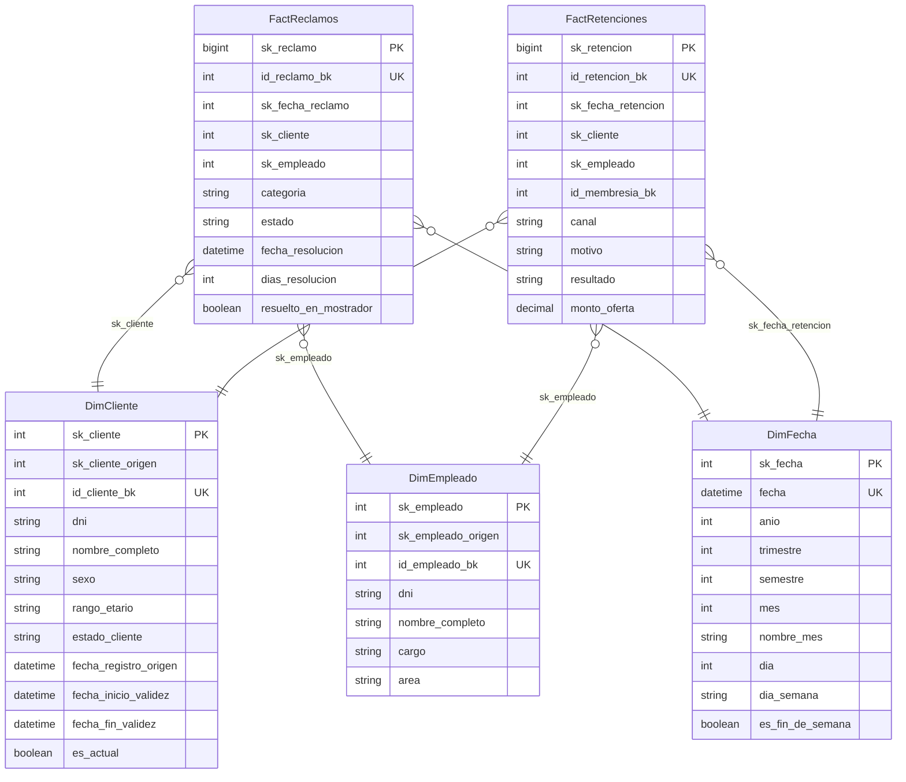
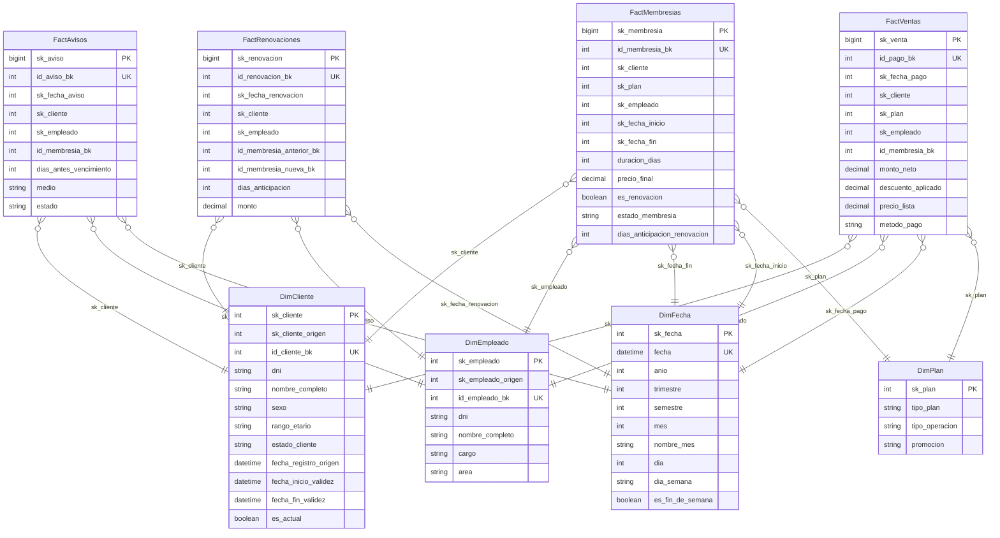
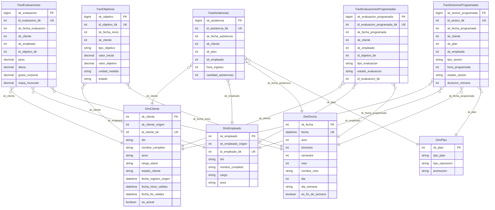

# ERD — Esquema BI_VIP_CENTER_FIT

> Generado automáticamente por `scripts/erd.mjs` desde `prisma/schema.prisma`.
> Modelos: 16. `PK` = clave primaria, `UK` = clave única.
>
> **Arquitectura: Data Warehouse en constelación.** El modelo tiene 3 data mart por área
> de negocio, cada uno una **estrella**, que **comparten las dimensiones conformadas** del
> Las relaciones provienen de las **FOREIGN KEY** declaradas en el DW.

## Vista general (constelación)

```mermaid
erDiagram
  DimCliente {
    int sk_cliente PK
    int sk_cliente_origen
    int id_cliente_bk UK
    string dni
    string nombre_completo
    string sexo
    string rango_etario
    string estado_cliente
    datetime fecha_registro_origen
    datetime fecha_inicio_validez
    datetime fecha_fin_validez
    boolean es_actual
  }
  DimEmpleado {
    int sk_empleado PK
    int sk_empleado_origen
    int id_empleado_bk UK
    string dni
    string nombre_completo
    string cargo
    string area
  }
  DimFecha {
    int sk_fecha PK
    datetime fecha UK
    int anio
    int trimestre
    int semestre
    int mes
    string nombre_mes
    int dia
    string dia_semana
    boolean es_fin_de_semana
  }
  DimPlan {
    int sk_plan PK
    string tipo_plan
    string tipo_operacion
    string promocion
  }
  FactAsistencias {
    bigint sk_asistencia PK
    int id_asistencia_bk UK
    int sk_fecha_asistencia
    int sk_cliente
    int sk_plan
    int sk_empleado
    int hora_ingreso
    int cantidad_asistencias
  }
  FactAvisos {
    bigint sk_aviso PK
    int id_aviso_bk UK
    int sk_fecha_aviso
    int sk_cliente
    int sk_empleado
    int id_membresia_bk
    int dias_antes_vencimiento
    string medio
    string estado
  }
  FactEvaluaciones {
    bigint sk_evaluacion PK
    int id_evaluacion_bk UK
    int sk_fecha_evaluacion
    int sk_cliente
    int sk_empleado
    int id_objetivo_bk
    decimal peso
    decimal altura
    decimal grasa_corporal
    decimal masa_muscular
  }
  FactMembresias {
    bigint sk_membresia PK
    int id_membresia_bk UK
    int sk_cliente
    int sk_plan
    int sk_empleado
    int sk_fecha_inicio
    int sk_fecha_fin
    int duracion_dias
    decimal precio_final
    boolean es_renovacion
    string estado_membresia
    int dias_anticipacion_renovacion
  }
  FactObjetivos {
    bigint sk_objetivo PK
    int id_objetivo_bk UK
    int sk_fecha_inicio
    int sk_cliente
    string tipo_objetivo
    decimal valor_inicial
    decimal valor_objetivo
    string unidad_medida
    string estado
  }
  FactReclamos {
    bigint sk_reclamo PK
    int id_reclamo_bk UK
    int sk_fecha_reclamo
    int sk_cliente
    int sk_empleado
    string categoria
    string estado
    datetime fecha_resolucion
    int dias_resolucion
    boolean resuelto_en_mostrador
  }
  FactRenovaciones {
    bigint sk_renovacion PK
    int id_renovacion_bk UK
    int sk_fecha_renovacion
    int sk_cliente
    int sk_empleado
    int id_membresia_anterior_bk
    int id_membresia_nueva_bk
    int dias_anticipacion
    decimal monto
  }
  FactVentas {
    bigint sk_venta PK
    int id_pago_bk UK
    int sk_fecha_pago
    int sk_cliente
    int sk_plan
    int sk_empleado
    int id_membresia_bk
    decimal monto_neto
    decimal descuento_aplicado
    decimal precio_lista
    string metodo_pago
  }
  etl_control {
    string proceso PK
    bigint ultimo_staging_id
    datetime ultima_carga
    bigint filas_ultima_carga
  }
  FactEvaluacionesProgramadas {
    bigint sk_evaluacion_programada PK
    int id_evaluacion_programada_bk UK
    int sk_fecha_programada
    int sk_cliente
    int sk_empleado
    int id_objetivo_bk
    string tipo_evaluacion
    string estado_evaluacion
    int id_evaluacion_bk
  }
  FactRetenciones {
    bigint sk_retencion PK
    int id_retencion_bk UK
    int sk_fecha_retencion
    int sk_cliente
    int sk_empleado
    int id_membresia_bk
    string canal
    string motivo
    string resultado
    decimal monto_oferta
  }
  FactSesionesProgramadas {
    bigint sk_sesion_programada PK
    int id_sesion_bk UK
    int sk_fecha_programada
    int sk_cliente
    int sk_plan
    int sk_empleado
    string tipo_sesion
    int hora_programada
    string estado_sesion
    int duracion_minutos
  }
  FactAsistencias }o--|| DimCliente : "sk_cliente"
  FactAsistencias }o--|| DimEmpleado : "sk_empleado"
  FactAsistencias }o--|| DimFecha : "sk_fecha_asistencia"
  FactAsistencias }o--|| DimPlan : "sk_plan"
  FactAvisos }o--|| DimCliente : "sk_cliente"
  FactAvisos }o--|| DimEmpleado : "sk_empleado"
  FactAvisos }o--|| DimFecha : "sk_fecha_aviso"
  FactEvaluaciones }o--|| DimCliente : "sk_cliente"
  FactEvaluaciones }o--|| DimEmpleado : "sk_empleado"
  FactEvaluaciones }o--|| DimFecha : "sk_fecha_evaluacion"
  FactMembresias }o--|| DimCliente : "sk_cliente"
  FactMembresias }o--|| DimEmpleado : "sk_empleado"
  FactMembresias }o--|| DimFecha : "sk_fecha_fin"
  FactMembresias }o--|| DimFecha : "sk_fecha_inicio"
  FactMembresias }o--|| DimPlan : "sk_plan"
  FactObjetivos }o--|| DimCliente : "sk_cliente"
  FactObjetivos }o--|| DimFecha : "sk_fecha_inicio"
  FactReclamos }o--|| DimCliente : "sk_cliente"
  FactReclamos }o--|| DimEmpleado : "sk_empleado"
  FactReclamos }o--|| DimFecha : "sk_fecha_reclamo"
  FactRenovaciones }o--|| DimCliente : "sk_cliente"
  FactRenovaciones }o--|| DimEmpleado : "sk_empleado"
  FactRenovaciones }o--|| DimFecha : "sk_fecha_renovacion"
  FactVentas }o--|| DimCliente : "sk_cliente"
  FactVentas }o--|| DimEmpleado : "sk_empleado"
  FactVentas }o--|| DimFecha : "sk_fecha_pago"
  FactVentas }o--|| DimPlan : "sk_plan"
  FactEvaluacionesProgramadas }o--|| DimCliente : "sk_cliente"
  FactEvaluacionesProgramadas }o--|| DimEmpleado : "sk_empleado"
  FactEvaluacionesProgramadas }o--|| DimFecha : "sk_fecha_programada"
  FactRetenciones }o--|| DimCliente : "sk_cliente"
  FactRetenciones }o--|| DimEmpleado : "sk_empleado"
  FactRetenciones }o--|| DimFecha : "sk_fecha_retencion"
  FactSesionesProgramadas }o--|| DimCliente : "sk_cliente"
  FactSesionesProgramadas }o--|| DimEmpleado : "sk_empleado"
  FactSesionesProgramadas }o--|| DimFecha : "sk_fecha_programada"
  FactSesionesProgramadas }o--|| DimPlan : "sk_plan"
```

## Data Mart: Atención y reclamos

`esquema: dm_atencion`

## Data Mart: Comercial — ventas y membresías

`esquema: dm_comercial`

## Data Mart: Entrenamiento

`esquema: dm_entrenamiento`

## Matriz bus (hecho → dimensiones conformadas)

| Data mart | Hecho | Dimensiones |
| --- | --- | --- |
| Atención y reclamos | FactReclamos | DimCliente, DimEmpleado, DimFecha |
| Atención y reclamos | FactRetenciones | DimCliente, DimEmpleado, DimFecha |
| Comercial — ventas y membresías | FactAvisos | DimCliente, DimEmpleado, DimFecha |
| Comercial — ventas y membresías | FactMembresias | DimCliente, DimEmpleado, DimFecha, DimPlan |
| Comercial — ventas y membresías | FactRenovaciones | DimCliente, DimEmpleado, DimFecha |
| Comercial — ventas y membresías | FactVentas | DimCliente, DimEmpleado, DimFecha, DimPlan |
| Entrenamiento | FactAsistencias | DimCliente, DimEmpleado, DimFecha, DimPlan |
| Entrenamiento | FactEvaluaciones | DimCliente, DimEmpleado, DimFecha |
| Entrenamiento | FactObjetivos | DimCliente, DimFecha |
| Entrenamiento | FactEvaluacionesProgramadas | DimCliente, DimEmpleado, DimFecha |
| Entrenamiento | FactSesionesProgramadas | DimCliente, DimEmpleado, DimFecha, DimPlan |

