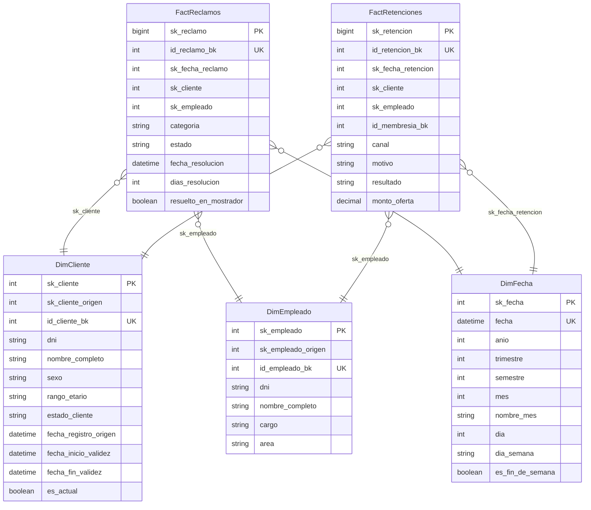

# ERD — Data Mart: dm_atencion

> Generado automáticamente por `scripts/erd.mjs` desde `prisma/schema.dm_atencion.prisma`.
> Modelos: 7. `PK` = clave primaria, `UK` = clave única.
>
> **Data Mart `dm_atencion`**: una **estrella** (sus hechos) más las
> **dimensiones conformadas** del esquema `dim` que comparte con el resto de la constelación.
> Las relaciones provienen de las **FOREIGN KEY** declaradas en el DW.

## Estrella: Atención y reclamos

`esquema: dm_atencion`

## Matriz bus (hecho → dimensiones conformadas)

| Data mart | Hecho | Dimensiones |
| --- | --- | --- |
| Atención y reclamos | FactReclamos | DimCliente, DimEmpleado, DimFecha |
| Atención y reclamos | FactRetenciones | DimCliente, DimEmpleado, DimFecha |

