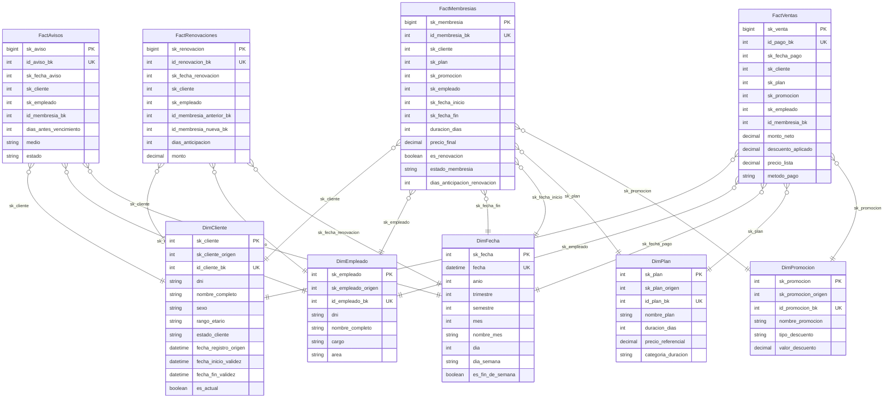

# ERD — Data Mart: dm_comercial

> Generado automáticamente por `scripts/erd.mjs` desde `prisma/schema.dm_comercial.prisma`.
> Modelos: 9. `PK` = clave primaria, `UK` = clave única.
>
> **Data Mart `dm_comercial`**: una **estrella** (sus hechos) más las
> **dimensiones conformadas** del esquema `dim` que comparte con el resto de la constelación.
> Las relaciones provienen de las **FOREIGN KEY** declaradas en el DW.

## Estrella: Comercial — ventas y membresías

`esquema: dm_comercial`

## Matriz bus (hecho → dimensiones conformadas)

| Data mart | Hecho | Dimensiones |
| --- | --- | --- |
| Comercial — ventas y membresías | FactAvisos | DimCliente, DimEmpleado, DimFecha |
| Comercial — ventas y membresías | FactMembresias | DimCliente, DimEmpleado, DimFecha, DimPlan, DimPromocion |
| Comercial — ventas y membresías | FactRenovaciones | DimCliente, DimEmpleado, DimFecha |
| Comercial — ventas y membresías | FactVentas | DimCliente, DimEmpleado, DimFecha, DimPlan, DimPromocion |

